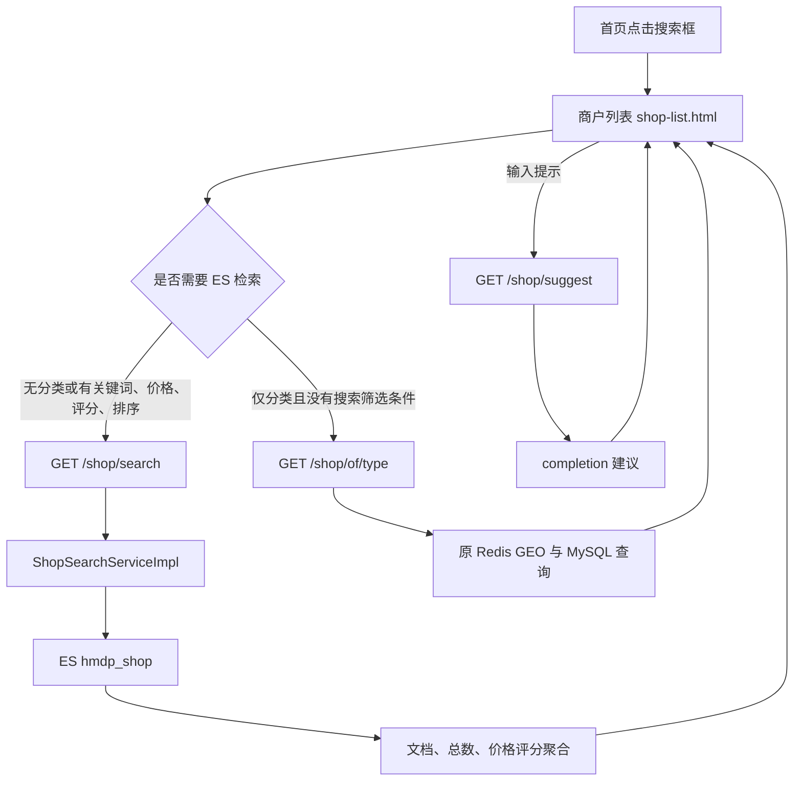
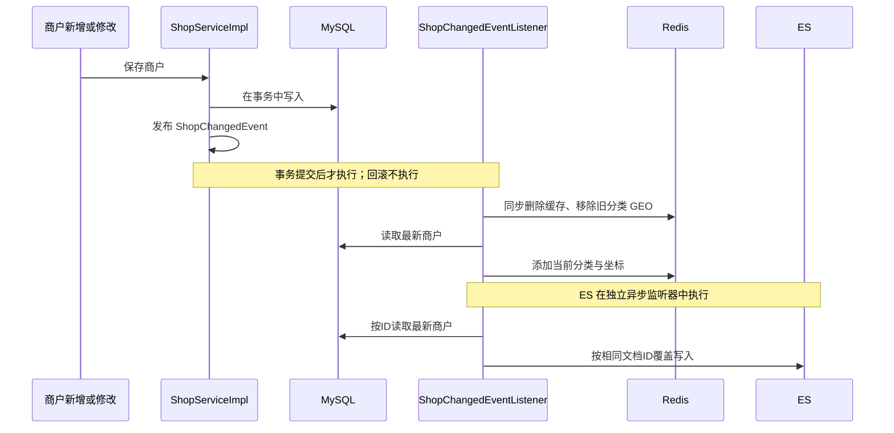

# HMDP 商户 ES 增强：功能取舍、修改记录与学习说明

> 整理日期：2026-10-09。
> 项目：`/path/to/hmdp-plus`。
> 本文以精简后的源码及 2026-10-09 的审查修复为依据。已补充提交后 Redis 同步、重建入口保护等正确性修复；仍未进行性能压测。

## 1. 我们最终要做成什么

我们的目标是做一个适合学习、演示和写进简历的 HMDP 增强版本。ES 的作用集中在“商户检索”：用户能够搜索商户，获得输入提示，再结合分类、价格、评分、附近范围和排序找到合适的商户。

这条链路需要完整、能运行，也需要你能解释每一步为什么这样写。没有必要为了覆盖 ES 的所有知识点，把课程项目扩展成完整搜索平台。

当前确定的范围是：

**商户关键词检索 → 拼音和首字母检索 → 输入补全 → 条件筛选与排序 → 高亮和分页展示 → 商户数据导入与同步。**

功能数量本身不能证明项目质量。我们更关注以下三个问题：

1. 这个功能解决了原项目中的什么具体问题？
2. 你能否从请求入口讲到查询和结果解析？
3. 有没有明确的样例和测试证明它正常工作？

目前可以说明“检索能力和交互方式得到扩展”。“响应时间降低多少”“吞吐量提升多少”需要另外测量，不能用小样本功能验收替代。

## 2. 为什么在 HMDP 中使用 ES

原项目已经有商户详情、分类列表、名称模糊查询和 Redis GEO 附近商户查询。引入 ES 是围绕商户搜索进行扩展，不是把原有功能全部重新做一遍。

| 需求 | 原有代码情况 | 这次的增强 |
| --- | --- | --- |
| 按名称找商户 | 原名称接口使用 MySQL 的名称模糊查询 | 用中文分词搜索名称、商圈和地址 |
| 体现不同字段的重要性 | 原名称查询没有多字段相关性排序 | 名称、商圈、地址采用不同权重 |
| 输入拼音或首字母 | 原名称模糊查询没有这套处理 | 支持商户名称全拼前缀和首字母前缀 |
| 输入时提供候选 | 原项目没有当前这套补全入口 | completion 返回中文商户名称 |
| 组合筛选 | 原名称接口没有当前组合搜索 DTO | 在一次查询中结合分类、价格、评分和地理条件 |
| 关键词高亮 | 原名称接口没有当前高亮处理 | 返回可安全展示的高亮字段 |
| 筛选统计 | 原名称接口没有当前区间聚合 | 返回价格和评分区间的数量 |

需要正确理解：MySQL 也能实现很多筛选，Redis 原本也能查询附近商户。ES 在本项目中的价值，是把全文检索、相关性、输入补全、地理条件和聚合组织到一条可讲解的检索链路中。我们没有验证“所有查询迁移到 ES 都更快”。

### 2.1 MySQL、Redis、ES 分别负责什么

| 组件 | 当前职责 |
| --- | --- |
| MySQL | 保存商户和原 HMDP 业务数据，商户新增、修改的依据仍然来自数据库 |
| Redis | 保留缓存、原分类 GEO 查询、登录及秒杀相关能力 |
| ES | 保存面向商户检索的文档，执行全文检索、补全、筛选、排序和聚合 |

搜索列表可以直接从 ES 文档中取展示字段。点击商户进入详情后，仍使用原商户详情接口及其缓存、数据库查询链路。

因此，数据库业务记录和 ES 检索文档是两个对象：`Shop` 对应数据库商户，`ShopDoc` 对应 ES 文档。

## 3. 功能取舍：哪些保留，为什么保留

| 保留能力 | 在商户搜索中的用途 | 值得学习的内容 |
| --- | --- | --- |
| 中文多字段检索 | 通过名称、商圈、地址找到商户 | Mapping、IK、multi_match |
| 字段权重 | 在相关性计算中提高名称匹配的重要性 | boost、相关性与业务字段排序的区别 |
| 拼音和首字母检索 | 输入 hai、haidilao、hdl 等查找名称 | 文档预处理、keyword、prefix |
| 输入补全 | 在用户输入时返回候选名称 | completion、建议输入与展示名称的区别 |
| 分类、价格和评分筛选 | 限定用户想要的商户 | bool.filter、term、range |
| 地理范围与距离排序 | 查找某个位置附近的商户 | geo_point、geo_distance、排序值解析 |
| 高亮 | 告诉用户关键词命中了哪里 | highlight、HTML 转义 |
| 总数和分页 | 展示匹配数量，分批读取结果 | SearchHits、from/size、trackTotalHits |
| 价格和评分聚合 | 为页面筛选项提供数量 | range aggregation、桶结果解析 |
| 商户全量导入和增量同步 | 让 ES 获取数据库商户数据 | Bulk、提交后事件、异步处理 |
| 基本失败检查 | 避免导入失败或参数错误被误认为成功 | Bulk 单项失败、参数校验、refresh |

这些能力共同服务一个场景。保留下来以后，你可以用“用户从输入关键词到找到商户”的过程串起代码。

### 3.1 为什么仍然保留导入检查和参数校验

虽然这是学习项目，但基本正确性仍然有价值。例如：

- HTTP 请求成功，但 Bulk 中部分文档失败，不能报告全部导入成功。
- 前端选择 4.5 分，后端应该能接受小数。
- 经度与纬度传错，应返回能理解的提示。
- 高亮交给 v-html 展示时，原文中的 HTML 需要转义。

这些检查直接支撑现有功能，不需要引入新组件或复杂平台。

## 4. 已经删除的内容及理由

### 4.1 删除笔记和用户的 ES 搜索

曾经扩展过“商户、笔记、用户”三个搜索标签页。代码能够运行，但这会把项目范围扩大成三套检索模块。

每多一套搜索，就需要理解和维护新的文档、Mapping、导入服务、查询逻辑以及同步方式。笔记的点赞数更新、用户资料变化，也会带来额外的数据同步要求。

你的简历主线是“用 ES 增强商户搜索”，因此删除这两套 ES 扩展可以减少阅读和维护负担。原 HMDP 的笔记、用户登录、关注等业务继续保留。

实际删除了以下 7 个 Java 文件：

| 文件 | 原作用 |
| --- | --- |
| `entity/BlogDoc.java` | 笔记 ES 文档 |
| `entity/UserDoc.java` | 用户 ES 文档 |
| `service/IBlogSearchService.java` | 笔记搜索接口 |
| `service/IUserSearchService.java` | 用户搜索接口 |
| `service/impl/BlogSearchServiceImpl.java` | 笔记检索和导入实现 |
| `service/impl/UserSearchServiceImpl.java` | 用户检索和导入实现 |
| `controller/SearchController.java` | 三类搜索及补全的统一入口 |

`SearchController` 中有用的商户补全没有丢掉，而是移到 `ShopController` 中。

对应的 `hmdp_blog`、`hmdp_user` 两个 ES 索引，先保存快照，再删除。MySQL 中的笔记、用户数据没有因此被删除。

### 4.2 删除统一搜索页，合并商户搜索入口

删除了三标签页的 `search.html`。首页搜索框现在直接进入已有的 `shop-list.html`，搜索、补全、筛选和结果卡片都在一个页面上完成。

这样避免维护两套商户结果展示，也不用额外理解标签切换、不同结果类型及其请求分支。

首页提示文字同步改为“搜索商户/拼音”。

### 4.3 删除多索引重建分支

原来重建接口支持 `type=shop/blog/user/all`。精简后只有商户索引，因此这些分支、服务注入和其他 Mapping 都删除了。

后续审查确认 HTTP 重建入口存在匿名删建风险，现已撤掉该路由及白名单。当前通过本地显式命令执行：

```text
mvn -Dtest=ShopIndexRebuildTest -Dhmdp.es.rebuild=true test
```

代码执行“检查商户 Mapping → 重建 hmdp_shop → 分批导入商户”。默认 mvn test/package 会跳过维护测试；不会通过页面、匿名请求或普通用户 HTTP 请求触发重建。执行前需要启动 MySQL、Redis、ES。

### 4.4 删除没有实际调用方的独立 count 方法

商户搜索响应已经提供 `total`，前端读取这个字段展示总数。独立 count 方法没有调用方，因此删掉接口声明、实现以及 CountRequest 导入。

删除 count 方法没有删除“搜索结果总数”能力。

### 4.5 删除没有展示用途的分类聚合

后端原本返回分类、价格、评分三类聚合。前端实际使用的是价格和评分区间数量，分类下拉来自原商户分类列表，没有消费分类聚合。

因此删除 `typeIdAgg` 的构建和解析，响应只保留 `priceAgg`、`scoreAgg`。

分类过滤继续使用 `termQuery("typeId", ...)`。删除的是分类统计，不是分类筛选。

### 4.6 删除没有被查询使用的字段和状态

- 删除 Mapping 中的 `all` 和相关 `copy_to`：当前搜索直接对名称、商圈、地址使用 multi_match，并分别设置权重。
- 删除 `area.keyword`：当前没有对这个子字段做精确查询、排序或聚合。
- 删除前端未使用的 `params.sortBy`：实际发送给后端的是 `sort`。
- 删除已经没有入口的 `/search/**` 白名单配置。
- 删除专属于被移除模块的测试内容，保留商户功能的回归测试。

`all`、copy_to 和 keyword 子字段本身都是有效的 ES 用法。这次删除的依据是当前代码没有使用它们，不应把这次取舍理解为这些功能不值得学习。

## 5. 没有加入的高级功能及取舍

以下内容不属于当前版本的必做清单，也没有为了展示 ES 知识而继续实现。

| 功能 | 当前取舍的依据 |
| --- | --- |
| function_score 综合排序 | 现有字段权重和距离、价格、评分排序已经满足演示场景；尚无明确的多因素评分规则 |
| 同义词分析器 | 需要先确认真实等价词，不能把同类餐饮名称直接当作同义词；当前没有必须依赖它的样例 |
| 索引别名切换 | 本地学习允许重建时短暂不可查询；没有无中断迁移要求 |
| 新 Java API Client 迁移 | 当前课程和代码采用 HLRC，先把现有请求及结果解析讲清楚，可以降低同时学习两套 API 的成本 |
| 新增同步组件 | 商户现有提交后异步事件足以展示基本链路，不扩展到消息平台或 binlog 同步 |
| 集群和复杂性能调优 | 当前以单机、小数据量验证功能，缺少需要针对性调优的运行指标 |

这里有两类情况：笔记、用户 ES 搜索是“写过以后删除”；function_score、同义词分析器、别名等是“没有接入当前版本”。不能把后者描述成已经完成的能力。

HLRC 已被官方标记为弃用。本项目沿用它是为了匹配本地学习环境，不能据此声称它是新项目的默认选型。[Elastic 7.17 客户端说明](https://www.elastic.co/guide/en/elasticsearch/client/java-rest/7.17/java-rest-high-create-index.html)。

## 6. 我具体做了什么：先修复，再精简

你提供记录之前，已经自行写了 ES 基础接入、商户高亮聚合，以及第三阶段的拼音、补全、笔记和用户搜索代码。

我的工作主要分成三部分：

1. 根据记录核对源码，修复使这些代码无法正常运行或结果不正确的问题，并执行验证。
2. 根据你明确提出的简历项目目标，删除不需要的扩展，合并入口，并重新验证保留的主线。
3. 核对后续审查意见，修复真实的一致性和权限缺口，并补充事务、真实服务及页面验证。

因此，不能把所有 ES 代码都归为本次新增。商户 ES 同步沿用你已有的事务事件链路；Redis 提交后同步是此次审查补上的修复。

### 6.1 修复建索引失败的根因

记录中的主要异常是：

```text
Failed to parse mapping [properties]
Root mapping definition has unsupported parameters
```

根因是当时的 `EsInitController`（现迁为 `ShopIndexMaintenance`）导入了旧版带类型的 CreateIndexRequest：

```java
// 原来导入的旧请求类。
import org.elasticsearch.action.admin.indices.create.CreateIndexRequest;

// 修正后使用 ES 7 无类型请求类。
import org.elasticsearch.client.indices.CreateIndexRequest;
```

旧请求发送了 `include_type_name=true`，把 properties 解释成旧 Mapping 类型名，后面的商户字段自然成了不支持的类型根参数。

我用相同 JSON 在本机做了对照：旧请求失败，无类型请求成功。这证明问题不在 JSON 的单行、多行格式，也不需要删除 completion、copy_to 等有效字段来绕过异常。

完整索引 JSON 使用 `source(...)` 时包含 mappings/properties 是有效结构。[Elastic 建索引说明](https://www.elastic.co/guide/en/elasticsearch/client/java-rest/7.17/java-rest-high-create-index.html)。

### 6.2 统一 ES 依赖版本

HLRC 虽然指定了 7.17.24，但 Spring Boot 管理的底层 REST Client 和 ES 核心依赖实际选成了 7.17.6。

我通过 Maven dependency:tree 确认了混用情况，再在 pom.xml 设置 `elasticsearch.version=7.17.24`，统一相关依赖。

Spring Boot 仍然是 2.7.4，Java 编译目标仍然是8。本机构建、运行使用 JDK17；这与“已在 JDK8 环境执行运行验收”是不同的结论。

### 6.3 修正 HLRC 的字段权重写法

REST JSON 中可以写 `name^3`。本项目采用的 HLRC QueryBuilder 应通过字段名和 boost 参数设置权重：

```java
// address 使用默认权重；名称、商圈分别设置 boost。
QueryBuilders.multiMatchQuery(keyword, "address")
        .field("name", 3.0f)
        .field("area", 2.0f);
```

直接把带 ^ 的字段字符串传给本项目的构造方式，曾生成重复权重形式，导致数字解析异常。该问题在真实查询中被发现并修正，也保留了对应回归测试。

REST DSL 的 ^ 写法本身不是错误，应区分 JSON 表达和 Java 构建 API。[Elastic multi_match 说明](https://www.elastic.co/guide/en/elasticsearch/reference/7.17/query-dsl-multi-match-query.html)。

### 6.4 修复拼音及补全输入

原来的拼音字段用 standard 分词，普通 match 不能直接实现连写拼音的前缀检索。原补全输入也主要是中文名称和商圈，没有完整接入拼音、首字母，还可能包含 null。

现在的处理为：

1. Java 层生成名称全拼、首字母，统一小写。
2. `namePinyin`、`nameInitials` 保存为 keyword，检索使用 prefix。
3. completion 提前写入中文名称、商圈及其拼音和首字母，过滤空值并去重。
4. 补全命中拼音后，读取命中文档的中文商户名作为候选展示。
5. 建议结果进行去重，最多返回8条名称。
6. 混合输入“海底捞hdl”“海底捞 hdl”分段查询，每一段必须命中；纯字母输入仍按原文或拼音前缀查询。

没有安装 ES 拼音插件；这套拼音能力来自 pinyin4j 和提前生成的文档字段。

### 6.5 修复评分小数与筛选区间

前端原来可以发送4.5，后端评分参数却是 Integer，导致绑定失败。评分选项写的是“3-4分”等区间，查询却只限制最低分，与页面含义不一致。

现在 minScore/maxScore 使用 Double，按实际评分传参。数据库与 ES 的 score 仍是乘10后的整数：4.5分对应45。

价格、评分区间均采用“包含下界、不包含上界”，与 range 聚合对应。例如：

- `[50,100)` 包含50，不包含100。
- `[4,4.5)` 包含4分，不包含4.5分。
- 4.5分以上只设置下界，5分也能包含在结果中。

这样同一商户不会在相邻区间的边界上被重复统计。

审查后将边界和标签统一放在 ShopSearchRanges。ES 聚合使用显式标签 key，解析不再用位置数组；页面通过 /shop/search/options 读取相同定义，前端没有另一份价格、评分区间。

### 6.6 分开地理范围和距离排序

原查询将“提供坐标和半径”同时作为距离排序的前提。我改为：

- 提供坐标，可以按距离排序。
- 另外提供正数半径，才增加范围过滤。
- 按距离排序时，从 sortValues 的第一个值读取距离，单位为米。
- 经纬度缺项、范围错误或无效半径在执行前返回提示。

距离为0米是有效结果，前端按 null 判断是否展示，不再把0当成“没有距离”。

页面普通搜索现在不发坐标或半径；距离排序只发坐标，不限制半径。原分类浏览保留附近5公里，并显示“杭州演示位置”的说明，避免把演示坐标当成用户实时定位。

### 6.7 修复导入失败处理和重建流程

之前笔记、用户的 Bulk 成功计数有错误，商户导入也可能只是打印失败后继续报告完成。我将逐条检查集中到 EsSearchSupport：成功条数逐条累计，失败时报告数量和首条原因。

虽然笔记、用户模块后来删除了，这套检查仍然用于商户导入。

全量 Bulk 使用 WAIT_UNTIL 等待刷新，让重建返回后更容易立即检索到数据。普通商户增量写入仍使用原来的默认刷新行为，不能把两条路径混为一谈。[Elastic refresh 说明](https://www.elastic.co/guide/en/elasticsearch/reference/7.17/docs-refresh.html)。

重建先使用临时索引校验 Mapping，再删除旧商户索引。删除前检查是否存在，连接、权限等真实异常不再被统一吞掉。

这可以避免错误 Mapping 先删掉旧数据，但仍然不是原子切换：导入中途失败时，新索引可能只有部分数据。

审查后改为按主键每次读取500条，再逐批 Bulk；任意一批出现单项失败就报错并停止后续批次。成功项不会自动撤销，这一事实已在真实 ES 临时索引中验证。

### 6.8 修复高亮与前端参数、布局

保留下来的修改包括：

- 高亮使用 HTML 编码；未高亮原文字段也进行转义，避免直接把用户原文当 HTML 渲染。
- 名称、商圈、地址等短字段返回完整高亮文本，避免只剩一个片段。
- Axios 参数序列化保留0/false，编码空格、&、+等特殊字符。
- 网络断开时不再读取不存在的 error.response.status。
- 调整搜索框和列表的弹性布局，解决窄屏横向溢出。
- 纯分类查询时也显示筛选入口，用户选中价格、评分等条件后可以切换到 ES。

中间版本还修复过统一搜索页错误提示、笔记摘要富文本等问题。这些页面或类后来已删除，它们不属于当前保留的功能。

### 6.9 修复原 Redis GEO 的版本兼容问题

本机运行 Redis5，原分类接口调用的 GEOSEARCH 从 Redis6.2 才提供，真实请求出现 unknown command。

我将原分类查询改为 GEORADIUS，并明确使用距离升序，再取当前页需要的前若干条。这样保留原查询路径，也不需要为本次 ES 精简升级 Redis。[Redis GEOSEARCH 版本说明](https://redis.io/docs/latest/commands/geosearch/)。

这是相邻入口的兼容性修复，不是 ES 的功能。

### 6.10 修复事务内 Redis 副作用和监听器日志

之前 update 在数据库事务内删除缓存、删除旧分类 GEO 并写入新坐标，saveShop 也提前写 GEO。MySQL 回滚不会撤销 Redis 操作，这是实际一致性缺口。

现在业务方法只写数据库和发布事件。事件携带旧分类，提交后同步监听器删除缓存、移除旧分类成员，再读取最新商户添加新坐标；新增也会清理可能存在的空值缓存。ES 保持独立的提交后异步监听器。两者均不在回滚时执行，且任一监听器失败不会阻断另一个。

日志改为 SLF4J，记录商户ID和完整异常栈，同时处理 IO 与运行时异常。没有引入自动重试或持久消息，这仍是最终一致方案。

## 7. 精简后的查询链路



### 7.1 bool 查询的分工

关键词放在 must 中。纯中文使用 multi_match；纯字母至少命中原文或拼音/首字母 prefix 之一。混合输入拆成中文、字母片段，各片段均须命中，例如“杭州 hdl”不能只匹配 hdl 就返回。

分类、价格、评分、地理范围放在 filter 中，用于限定结果，不参与相关性评分。

当前权重为名称3、商圈2、地址1；拼音与首字母前缀分支 boost 为2。权重影响评分，不意味着名称匹配在任何输入情况下都无条件排第一。

### 7.2 相关性排序和商户评分排序

| sort 参数 | 含义 |
| --- | --- |
| default 或未指定 | 按 ES 相关性 _score 降序 |
| price | 按 avgPrice 升序 |
| score | 按商户评分字段 score 降序 |
| distance | 按相对传入坐标的距离升序 |

主排序值相同时追加 id 排序，减少固定数据下翻页顺序的不确定性。当前仍是 from/size 分页，没有实现并发数据变化下的快照分页。

### 7.3 聚合统计的是哪个范围

priceAgg、scoreAgg 基于当前查询命中的文档统计。选中某个价格区间后，其他区间可能变为0，这是当前筛选范围内的统计，不是独立的全站商户分布。

当前没有实现“忽略当前维度筛选后再统计选项数量”的多维筛选统计逻辑。

价格和评分的界面选项来自同一份后端区间定义，聚合桶用显式 key 关联标签，不依赖桶的返回顺序。

## 8. 文档结构、拼音和坐标

| 字段 | 类型或处理 | 用途 |
| --- | --- | --- |
| id | keyword，写入时也作为文档ID | 对齐数据库主键、覆盖写入、排序辅助 |
| name、area、address | text + ik_max_word | 中文检索及高亮 |
| namePinyin、nameInitials | keyword | 名称全拼、首字母前缀检索 |
| typeId | long | 分类过滤 |
| avgPrice | long | 价格过滤、排序、聚合 |
| score | integer，保存实际评分乘10 | 评分过滤、排序、聚合 |
| sold、comments | integer | 商户文档中的业务统计字段；没有用于当前综合评分公式 |
| images | 不索引的 keyword | 卡片图片展示 |
| location | geo_point | 地理范围及距离排序 |
| suggestion | completion + keyword 分析器 | 提前生成的输入候选 |

distance 是结果返回时填充的值，当前依靠距离排序值解析，不能保证所有排序模式都返回距离。

### 8.1 经纬度不能混用

- 请求参数：x 是经度，y 是纬度。
- ShopDoc 的 location 字符串是“纬度,经度”，即 y,x。
- 当前 HLRC 的 point 和 geoDistanceSort 传入纬度、经度，即 y,x。

不要因为习惯写 x,y 就改变现有参数顺序；不同 geo_point 表达形式的顺序需要分别确认。

### 8.2 拼音能力的实际边界

海底捞可以生成 haidilao 和 hdl，输入 hai 或 hdl 可进行前缀查询。大小写和空格会归一化，例如 HAI DI 会变为 haidi。

这不是任意位置的拼音子串查询，也不是错字纠正。pinyin4j 当前对多音字取第一个读音，特殊品牌读音没有维护词典。

正式搜索已支持中文与拼音混合输入；completion 仍是预先生成词条的前缀补全，不承诺任意混合输入也能给出候选。

completion 只是给候选，不等同于正式检索。选择完整商户名后仍执行多字段全文查询，其他商户可能因为共同的商圈、地址或名称分词被命中；不能把候选点击理解为按商户ID精确查找。

## 9. 商户数据是怎么进入 ES 的

### 9.1 全量导入

```text
显式运行 ShopIndexRebuildTest（hmdp.es.rebuild=true）
  → 临时索引检查 Mapping
  → 删除已有 hmdp_shop
  → 创建 hmdp_shop
  → 按主键分页读取 MySQL 商户（每批500条）
  → ShopDoc.from 转换
  → Bulk 按商户ID写入
  → 等待刷新，逐条检查失败
```

全量导入已分批读取，但仍是本地维护任务，没有限流或在线无中断重建。

### 9.2 增量同步



使用 AFTER_COMMIT 的原因，是避免数据库回滚后，尚未成功保存的数据进入 Redis GEO 或 ES。读取数据库完整商户，也避免把只包含几个更新字段的请求体当作完整文档写入。

这是一套内存事件，不是持久化消息。应用崩溃、Redis/ES 操作失败可能造成不同步；失败记录带异常栈的日志。ES 可通过本地重建修复；Redis 启动初始化只补现有商户坐标，不保证清理历史脏成员。没有自动重试、持久化补偿或事件版本控制，也不保证并发更新没有短暂竞态。

当前根本没有商户删除接口，业务范围只有新增和修改；本版没有新增删除功能或其同步。syncById 遇到不存在的数据库记录会直接返回，因此绕过应用直接删数据库记录，ES 不会自动删除对应文档。

原 /shop/of/name 仍由 blog-edit.html 调用，用于发布笔记时选择商户，属于保留业务入口，并非孤儿代码。

## 10. 文件变化与代码阅读顺序

Java 文件统一位于 `src/main/java/com/hmdp`。建议按下面的顺序阅读，先理解字段和数据，再看请求、查询和同步。

| 顺序 | 文件 | 阅读重点 |
| --- | --- | --- |
| 1 | [EsConstants.java](/path/to/hmdp-plus/src/main/java/com/hmdp/constants/EsConstants.java) | 当前唯一的商户 Mapping，哪些字段检索、过滤或展示 |
| 2 | [ShopDoc.java](/path/to/hmdp-plus/src/main/java/com/hmdp/entity/ShopDoc.java) | Shop 转文档、拼音、补全输入和 location |
| 3 | [PinyinUtil.java](/path/to/hmdp-plus/src/main/java/com/hmdp/utils/PinyinUtil.java) | 全拼、首字母、归一化与多音字边界 |
| 4 | [ShopSearchDTO.java](/path/to/hmdp-plus/src/main/java/com/hmdp/dto/ShopSearchDTO.java) | 请求条件、默认页码和评分单位 |
| 5 | [ShopSearchServiceImpl.java](/path/to/hmdp-plus/src/main/java/com/hmdp/service/impl/ShopSearchServiceImpl.java) | buildQuery → search → parseResponse/parseAggregations → suggest |
| 6 | [ShopSearchResult.java](/path/to/hmdp-plus/src/main/java/com/hmdp/dto/ShopSearchResult.java) | list、total、aggregations 的返回结构 |
| 7 | [ShopController.java](/path/to/hmdp-plus/src/main/java/com/hmdp/controller/ShopController.java) | search 和 suggest 两个入口 |
| 8 | [ShopIndexMaintenance.java](/path/to/hmdp-plus/src/main/java/com/hmdp/service/ShopIndexMaintenance.java) | 本地单索引检查、重建和导入；无 HTTP 路由 |
| 9 | [EsSearchSupport.java](/path/to/hmdp-plus/src/main/java/com/hmdp/utils/EsSearchSupport.java) | 分页边界和 Bulk 单项失败检查 |
| 10 | [ShopServiceImpl.java](/path/to/hmdp-plus/src/main/java/com/hmdp/service/impl/ShopServiceImpl.java)、[事件监听器](/path/to/hmdp-plus/src/main/java/com/hmdp/listener/ShopChangedEventListener.java) | 商户事务、事件发布、提交后同步及原GEO兼容处理 |
| 11 | [shop-list.html](/path/to/hmdp-plus/src/main/resources/nginx-1.18.0/html/hmdp/shop-list.html) | 接口切换、补全、筛选条件、分页和展示 |

EsConfig 负责客户端 Bean，pom.xml 负责依赖版本。首页 index.html 的改动主要是搜索入口和提示文字；WebMvcConfig 删除了废弃搜索入口的白名单；common.js 的改动是参数编码与网络错误处理。

本次精简的逐文件清单位于备份目录中的 `变更清单.json`，包含删除和修改两组文件。

## 11. 已经做过的验证及其证据

下面先记录先前精简版本的历史验收；它不能替代此次审查修复后的新验证。后续修复记录见 11.2 节。

| 验证类型 | 结果 | 能证明什么 |
| --- | --- | --- |
| 干净构建 | mvn -o clean package 通过 | 删除文件后没有依赖残留造成的编译和打包错误 |
| 回归测试 | 8项通过，0失败、0错误 | 拼音、补全输入、Bulk失败统计、分页边界、小数评分绑定和权重格式正常 |
| 真实接口 | 28项通过 | 重建、14条商户检索、筛选区间、距离、补全及保留的原入口正常 |
| 真实浏览器 | 9项通过 | 首页跳转、补全选择、高亮、评分筛选、分类切换和窄屏展示正常 |

真实接口检查还确认了：

- 响应聚合只包含价格和评分两个维度。
- all、area.keyword 已从重建后的 Mapping 移除。
- 打包产物没有残留删除的搜索类或 search.html。
- 商户索引保持14条文档。
- 原笔记首页和原分类附近商户查询仍可使用。

浏览器使用独立 Edge 配置进行验收，并查看了真实截图；不只检查 HTML 文件文本。

### 11.1 不应从这些验证推导出的结论

- 14条数据不能证明百万级数据下的性能。
- 功能验收没有测量吞吐量、P95/P99 或并发稳定性。
- 8项回归测试没有覆盖整个 HMDP。
- 28项接口检查没有包含新增/修改后同步的完整端到端测试，也没有覆盖事务回滚、应用崩溃和故障重试场景。
- 同步链路的说明依据现有源码，不等于保证消息绝不丢失。
- 原笔记首页可用和原业务源码一致，不等于重新验收了所有登录、关注、秒杀功能。

保存的证据位于精简前备份目录：

```text
/path/to/local-file
├─ 变更清单.json
├─ live-verification.json
├─ browser-verification.json
├─ shop-search.png
├─ hmdp_shop-snapshot.json
├─ hmdp_blog-snapshot.json
└─ hmdp_user-snapshot.json
```

### 11.2 本次审查修复的验证

普通测试覆盖原8项回归、6项 Spring 事务提交/回滚及失败隔离、2项真实 HLRC 对本地 HTTP 替身的分批/部分失败测试。显式维护测试和4项本机集成测试默认跳过，不会在普通构建时重建索引或修改数据库。

本机集成的4项均已通过：更新回滚保留数据库/GEO/缓存/ES；新增回滚不留 GEO/ES；提交更新后同步并恢复原商户；真实 ES Bulk 部分失败后成功项仍在、失败项不存在。测试临时索引已清理，商户数据已恢复。

本轮证据保存在：

```text
/path/to/local-file
```

最终干净构建、真实接口和浏览器结果见 [ES审查与修复记录.md](/path/to/hmdp-plus/ES审查与修复记录.md)。这些验证仍不代表整个 HMDP 的测试覆盖或性能压测。

## 12. 怎么自己演示和检查

当前需要本机 MySQL、Redis、ES、后端和 Nginx 可用。端口分别为3306、6379、9200、8081、8080。服务是否正在运行需要在实际操作时检查，本文不承诺它们一直保持启动。

### 12.1 页面演示

1. 打开首页，点击“搜索商户/拼音”，进入商户列表。
2. 搜索“火锅”，观察高亮、结果总数和商户卡片。
3. 输入 hai 或 hdl，观察中文商户补全，选择海底捞候选。
4. 选择“4.5分以上”，再选择“4-4.5分”，比较结果区间。
5. 选择价格、距离等排序；进入一个分类后再选择评分筛选，理解查询路径切换。

### 12.2 接口示例

```text
GET /shop/search?keyword=火锅
GET /shop/search?keyword=hai
GET /shop/suggest?keyword=hdl
GET /shop/search?minScore=4.5
GET /shop/search?minScore=4&maxScore=4.5
GET /shop/search?minPrice=50&maxPrice=100
GET /shop/search?x=120.149993&y=30.334229&sort=distance
GET /shop/search?x=120.149993&y=30.334229&radius=5000&sort=distance
```

示例需要 URL 编码时，可由浏览器、Postman 或请求工具完成。通过 Nginx 访问接口时加 `/api` 前缀，直接访问8081后端时不加该前缀。

重建示例：

```powershell
# 在项目根目录显式运行：删除并重新导入商户 ES 索引。
# 需要 MySQL、Redis、ES 可用，默认构建不会执行此维护操作。
mvn -Dtest=ShopIndexRebuildTest -Dhmdp.es.rebuild=true test
```

该命令不会删除 MySQL 商户，但会替换 ES 商户索引。HTTP 重建接口已移除，匿名和已登录普通用户均无法通过 HTTP 重建。商户新增、修改接口补了登录校验；项目没有完整管理员角色权限模型。

### 12.3 如何理解同步演示

如果要另外验证商户修改后的同步，应先记录商户原值，再通过原修改接口更新可恢复字段，查看 MySQL 和 ES 是否最终一致，然后恢复原值。普通增量写入可能要等待刷新后才能搜索到，不能将短暂不可见直接等同于写入失败。

本轮另外做了4项本机集成验收，不混入之前28项历史接口检查。自行复现可运行：

```powershell
mvn -Dtest=ShopSyncIntegrationTest -Dhmdp.es.integration=true test
```

该测试会临时更新商户1并在 finally 中恢复，也会验证新增回滚及临时索引 Bulk 失败；只在自己的学习环境显式执行。新增回滚不留下记录，但 MySQL 自增ID可能有空号，这是正常现象。

## 13. 当前有意接受的限制

| 限制 | 当前事实及取舍 |
| --- | --- |
| 数据规模小 | 现有商户14条，优先验证功能，没有性能提升结论 |
| 坐标是演示坐标 | 页面默认使用杭州附近固定坐标，没有接入真实用户定位 |
| 两条地理查询路径 | 原分类浏览是附近5公里；普通 ES 搜索不限地理范围，距离排序使用杭州演示坐标且不设半径；页面已提示差异 |
| 拼音存在边界 | 名称前缀/首字母，不支持任意位置拼音子串；多音字取首个读音 |
| 全文查询可能较宽 | 默认多字段检索不是完整店名的精确查询，共同分词可能带来其他结果 |
| 分页窗口有限 | 每页1至100条，current × pageSize 不超过10000，没有深分页实现 |
| 同步为最终一致 | Redis提交后更新、ES提交后异步及默认刷新；没有持久化重试或并发版本控制；当前无商户删除业务 |
| 重建会短暂影响搜索 | 先预检，再删建导入，没有别名原子切换 |
| 聚合依赖当前条件 | 返回当前查询范围内的价格、评分数量，不是独立全站统计 |

这些边界应能解释清楚，但不意味着现在就要逐项增加新功能。当前目标是把保留下来的商户检索代码学透，并提供真实的演示与验证依据。

## 14. 简历和面试如何表述

### 14.1 当前可以使用的表述

> 基于 Elasticsearch 改造 HMDP 商户检索模块，支持中文多字段检索、拼音及首字母检索、输入补全和地理范围过滤；实现分类、价格、评分组合筛选、结果高亮与区间聚合，并接入商户数据导入和提交后异步同步。

这是功能描述，没有编造速度或规模。商户同步的边界可以在面试中进一步说明。

### 14.2 可以按这个顺序讲项目

1. 原有名称查询比较单一，希望用户通过名称、商圈、地址和条件找到商户。
2. 用 ShopDoc 将数据库商户转换为检索文档，确定分词、拼音和地理字段。
3. 用 multi_match 和字段权重处理关键词，用 bool.filter 处理确定条件。
4. 用 completion、highlight 和区间聚合改善交互。
5. 用 Bulk 完成初始导入，用事务提交后的事件处理商户新增、修改。
6. 解释采用单索引、单页面的原因，以及小样本、刷新和内存事件的边界。

不应将当前版本描述成大规模生产搜索平台、毫秒级高并发验证成果或无丢失实时同步系统。

## 15. 备份、恢复和阅读建议

本轮审查修复前的源码、文档、续接状态、商户索引快照与验证证据另存于：

```text
/path/to/local-file
```

精简前完整源码、旧文档、原续接状态，以及三个业务索引的快照位于：

```text
/path/to/local-file
```

更早的修复前备份位于：

```text
/path/to/local-file
```

精简没有删除 hotel 等 ES 学习索引，也没有删除 MySQL 笔记、用户数据。两个废弃 ES 索引快照是恢复资料，不是仍然运行的搜索功能。

如需恢复旧版本，应根据变更清单恢复对应文件，避免整目录覆盖你后来新增的代码；再重新编译，并按恢复版本的 Mapping 和导入逻辑重建相关索引。快照中的元数据不能直接不加筛选地当作建索引请求提交。

学习时先读第3、4、5节理解取舍，再按第10节阅读代码。最后用第12节演示请求，并对照第11、13节区分“已验证的能力”和“当前接受的限制”。
