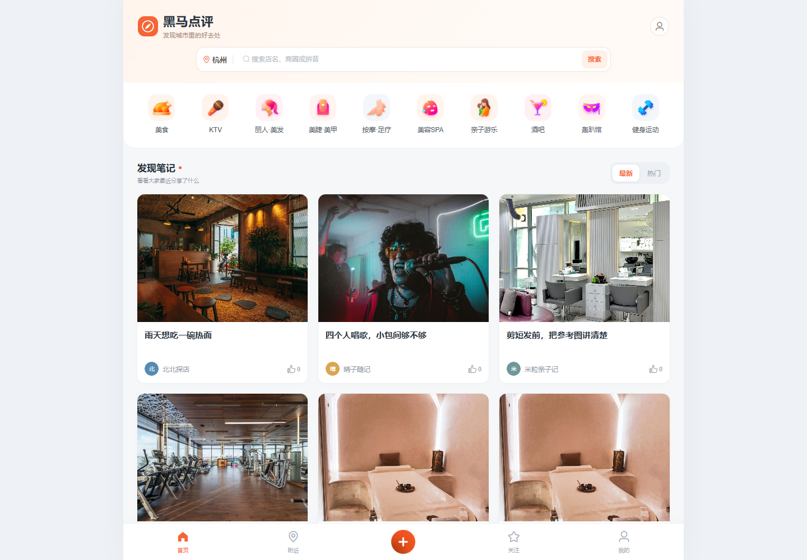
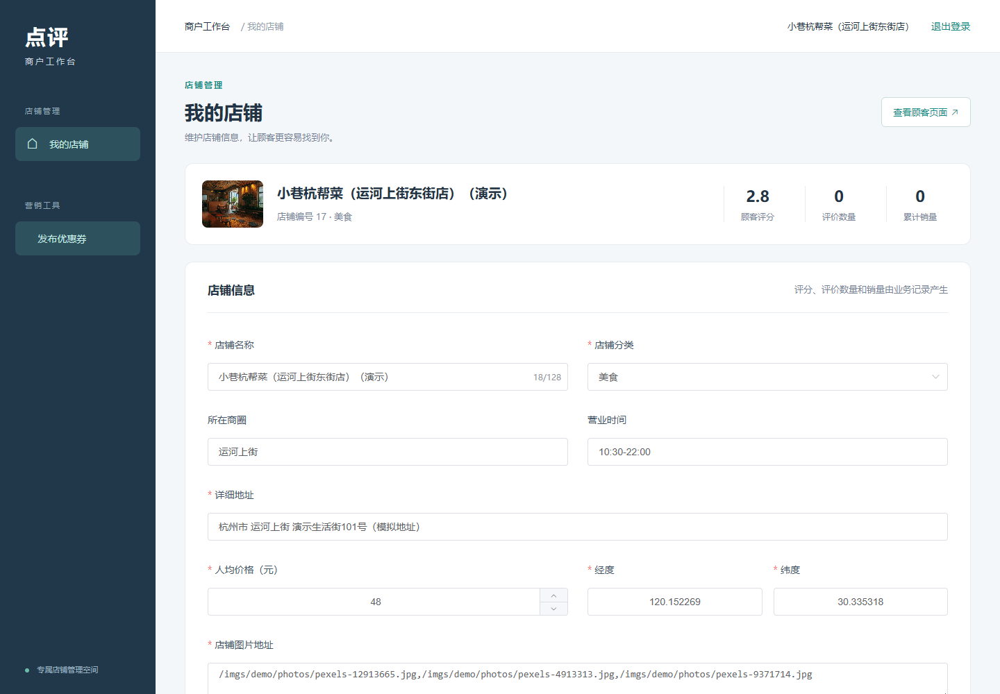
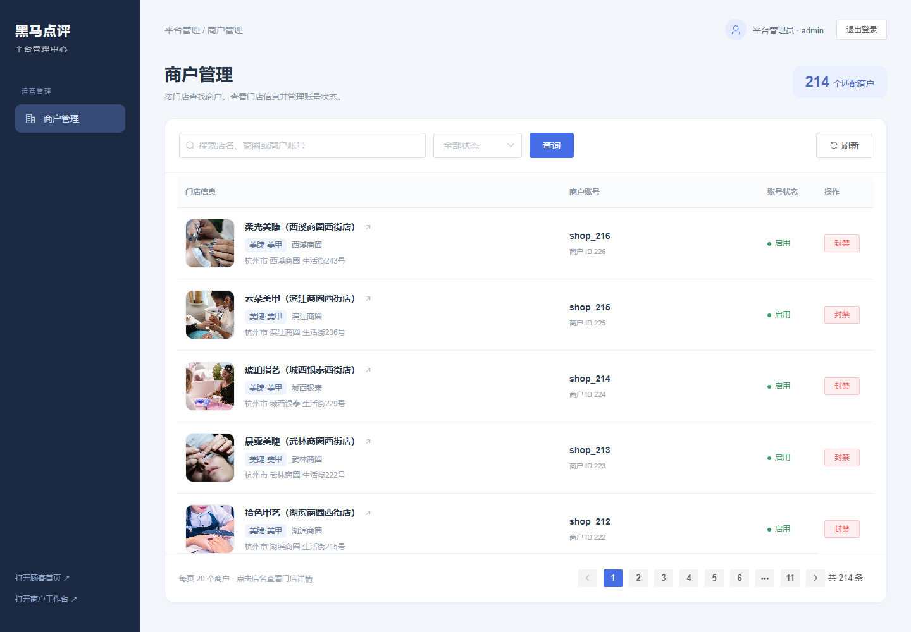
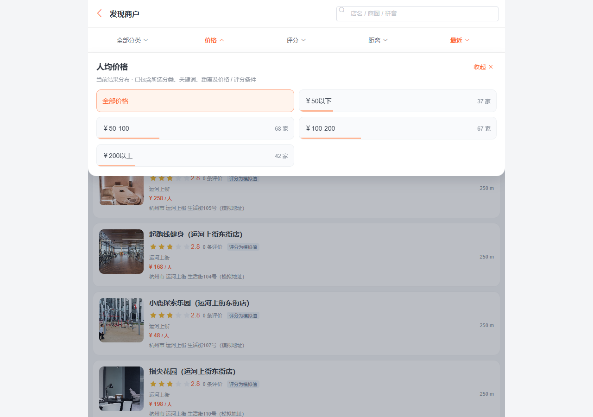
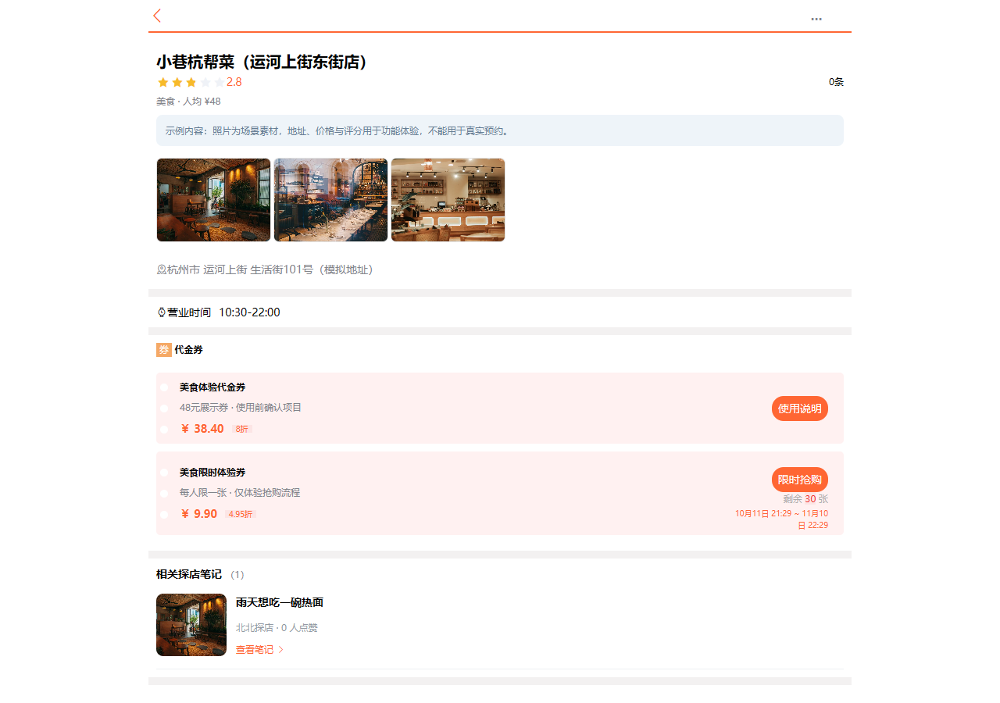
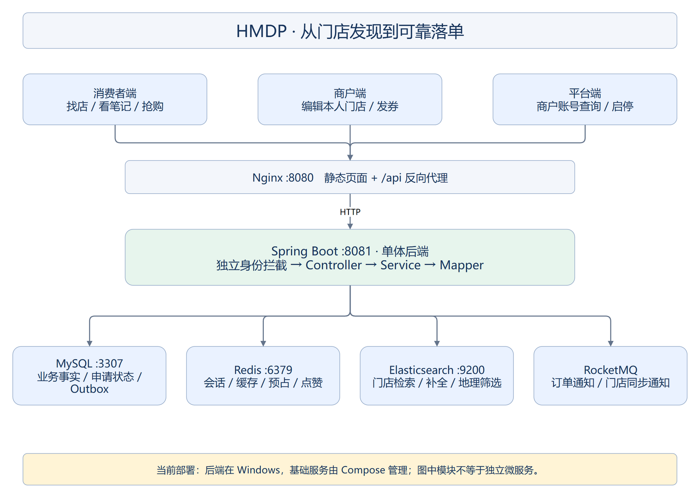

# HMDP Plus · 黑马点评三端改造实战

**Spring Boot · Redis · Elasticsearch · RocketMQ · MySQL · Docker**

一个可以看源码、运行三端页面、验证消息可靠性并部署到服务器的 Java 后端学习项目。基于黑马点评课程继续改造，重点补齐 **消费者端、商户工作台、平台管理端**，以及 **秒杀可靠下单、商户 ES 增量同步、本地开发与云端部署**。

[快速启动](#快速启动) · [三端预览](#三端预览) · [核心改造](#核心改造) · [项目文档](#项目文档) · [测试与性能](#测试与性能) · [来源与使用](#来源与使用)

> 项目使用演示门店、笔记和场景摄影素材，不代表真实商家服务或交易。没有真实短信、支付、退款、核销系统；适合学习、运行演示与继续开发。

## 项目能做什么

| 入口 | 主要功能 | 本地地址 |
| --- | --- | --- |
| 消费者端 | 登录、门店/分类浏览、关键词/拼音搜索、组合筛选、笔记、点赞/关注、抢券与结果查询 | `http://localhost:8080/` |
| 商户端 | 独立登录、本人门店信息与图片地址维护、发布普通券/秒杀券 | `http://localhost:8080/merchant/login.html` |
| 平台端 | 独立登录、商户查询与分页、账号封禁/解封、会话版本失效 | `http://localhost:8080/platform/login.html` |

三个身份使用独立会话命名空间与权限拦截。商户管理接口位于 `/admin/**`，平台接口位于 `/platform/**`；商户网页路径与 API 路径并不相同。

## 三端预览

### 消费者端：发现门店与阅读笔记



支持关键词/拼音检索、价格/评分/距离筛选、补全和高亮；附近与分类列表统一走 ES。当前演示使用杭州参考坐标，未接入设备真实定位。

### 商户端：管理自己的门店



商户身份决定可编辑门店，字段白名单保护评分、销量等业务字段。修改提交后失效缓存，并通过 Outbox + MQ 同步 ES。

### 平台端：管理商户账号



按门店、商圈和账号查询商户；封禁递增会话版本，解封后旧会话也不会自动恢复。截图来自已扩充的本机演示环境，空库账号需自行初始化。

<details>
<summary>更多页面：搜索筛选、门店详情、探店笔记</summary>





</details>

## 核心改造

### 1. 秒杀可靠下单

`HTTP受理 → MySQL持久化申请 → 两段事务与UNKNOWN证据 → Redis Lua预占 → RocketMQ → MySQL事务落单`

- 申请状态与预占状态分开保存；预检只读，正式预占在持久意图提交后执行。
- Lua 按申请 ID 幂等预占，库存、归属、预占凭据一起处理。
- 后台恢复任务推进预占、发送和补偿，发送未知时保留证据，不立即退库存。
- 消费事务完成扣库存、写订单及成功状态；申请行锁与一人一券唯一索引协同裁决。
- 失败终止先进入 CANCELLING，再幂等释放并记 FAILED；凭据不足保留待核查状态。
- 前端拿到申请 ID 后查询最终结果；受理成功与订单创建成功分开表达。

### 2. 商户数据到 ES 的可靠同步

`商户写事务 → Outbox(PENDING) → MQ → 同快照读取商户与revision → ES external_gte`

- 同一商户只有一行 Outbox，连续修改递增 revision。
- 抢发送租期、发送确认及失败退避都带 revision 条件，旧发送不能确认新版本。
- 消费者读取当前数据库内容，ES 外部版本拒绝迟到旧写；同版本允许重试。
- 死信错误按版本记录，支持核查后的人工重放。SENT 仅代表发送成功，不代表 ES 已更新。
- Redis 缓存失效仍走提交后事件，ES 同步走持久链路。

### 3. ES 门店检索与缓存

关键词 must、条件 filter、拼音/首字母、补全、高亮、地理排序与聚合；批量导入检查部分失败。详情采用穿透缓存与空值缓存。分类缓存读取改用共享 Jackson，修复压测中暴露的 Hutool 转换类加载阻塞。

### 4. 三端权限与轻社交

消费者、商户、平台身份分离；商户编辑字段白名单；关注先锁用户行再查询关系；保留笔记、ZSet 点赞及作者列表，裁剪未使用的 Feed、共同关注、GEO、签到演示链路。



流程图的可编辑 `.drawio` / `.mmd` 源文件保存在 [讲义配图目录](docs/assets/hmdp-guide)。

## 技术栈

| 层次 | 选择 |
| --- | --- |
| 后端 | Spring Boot 2.7.4、MyBatis-Plus 3.5.2，Java 8编译目标，JDK 17运行/构建验证 |
| 存储与缓存 | MySQL 8.0、Redis 6.2.4、Redisson 3.20.0 |
| 搜索 | Elasticsearch 7.17.24、IK 7.17.24、HLRC、pinyin4j |
| 消息 | RocketMQ 5.3.2、rocketmq-spring-boot-starter 2.3.4 |
| 前端 | Vue 2、Element UI、Axios、静态 HTML/JS/CSS |
| 部署与检查 | Docker Compose、Nginx、JUnit 5、Mockito、Python 标准库压测工具 |

## 快速启动

### 方式 A：本地开发，Docker 配合 IDEA

适合阅读代码、修改业务和断点调试。Docker 只运行依赖，Java 后端从 IDEA 启动。

```powershell
git clone https://github.com/hekaihua666/hmdp-plus.git
cd hmdp-plus
Copy-Item deploy/.env.example deploy/.env
# 编辑 deploy/.env，设置自己的 DB_PASSWORD
powershell -ExecutionPolicy Bypass -File deploy/prepare-ik.ps1
docker compose --env-file deploy/.env -f deploy/compose.local.yaml build elasticsearch
.\start-local.bat
```

在 IDEA 打开根目录 `pom.xml`，选择 JDK 17 和运行项 **HMDP - 本地开发 (IDEA)**。新环境首次按 [部署说明](docs/DEPLOYMENT.md) 初始化 Topic 与 ES，再启动 Java。

启动脚本会生成本机私人配置，不把密码写进共享运行项。完整步骤及切换方式见 [本地开发指南](docs/LOCAL_DEVELOPMENT.md)。

### 方式 B：服务器完整 Docker 部署

后端和中间件全部由 Docker 运行，服务器无须安装 IDEA。

```bash
git clone https://github.com/hekaihua666/hmdp-plus.git
cd hmdp-plus
cp deploy/.env.example deploy/.env
# 编辑 deploy/.env，填写自己的密码
bash deploy/prepare-ik.sh
```

接着按 [Docker 部署指南](docs/DEPLOYMENT.md) 的顺序：创建卷 → 启动依赖 → 初始化数据库/Topic/ES → 启动后端与 Nginx。

- 新环境导入 **214家门店、10种分类、54篇笔记及合成作者**；不带原用户、密码、会话和订单。
- 后台账号不提供通用默认密码，按 [账号初始化](docs/ACCOUNTS.md) 创建自己的平台与商户账号。
- 本地开发与全容器模式复用一套卷，应按文档切换；不要同时启动两个后端。
- 端口：网页8080、后端8081、MySQL宿主机3307、Redis6379、ES9200、NameServer9876、Broker10911/10909。

## 测试与性能

默认回归：

```bash
mvn test
```

本轮本机记录为 **102项，96通过、6项显式集成/维护测试默认跳过，0失败、0错误**。真实依赖集成和删建索引的维护工具需要显式启用，普通测试不会重建业务索引。

### 已完成的云端测量

4核8GiB Ubuntu 22.04 ECS，压测器与服务同机回环访问后端，每档30秒，关键并发48/100复测一次：

| 场景 | 48并发两轮吞吐 | 两轮p95 |
| --- | --- | --- |
| 分类列表 | 4387—4444 req/s | 21.30—21.95 ms |
| 店铺缓存 | 3922—4032 req/s | 22.87—24.59 ms |
| ES搜索 | 1516—1544 req/s | 43.25—44.40 ms |

上述各档业务失败、HTTP错误、传输异常均为0。搜索使用固定关键词；同机资源竞争、样本时长和请求口径影响数字，不把这些结果当作独立压测机或生产集群容量。

秒杀完成过一轮正确性验收：50名不同用户、20张库存，最终20条成功申请、30条失败申请、20笔订单，重复订单用户数0，MySQL与Redis库存均为0。该有限批次未测持续高负载吞吐。

压测工具见 [使用说明](deploy/loadtest/README.md)，实际处理记录见 [部署与压测结果](docs/HMDP部署与压测处理结果.md)。旧秒杀重置脚本已停用，测试使用独立新券。

## 项目文档

| 想了解什么 | 文档 |
| --- | --- |
| 按业务与源码学习整个项目 | [项目实战讲义](docs/HMDP项目实战讲义.md) / [HTML版](docs/HMDP项目实战讲义.html) |
| 本地 IDEA 开发 | [本地开发指南](docs/LOCAL_DEVELOPMENT.md) |
| Docker / Linux 部署 | [部署指南](docs/DEPLOYMENT.md) |
| 平台与商户账号 | [账号初始化](docs/ACCOUNTS.md) |
| MQ 状态机、重试与补偿 | [MQ设计](docs/mq-design.md) |
| Outbox revision 与 ES 版本 | [商户同步修复与验收](docs/shop-sync-verification.md) |
| 商户与平台功能 | [商户设计](docs/商户后台使用与设计.md) / [平台设计](docs/平台后台使用与设计.md) |
| 社交裁剪与页面改造 | [第8—12章详解](docs/第8-12章改装设计与源码详解.md) |

## 目录结构

```text
.run/                      IDEA共享运行项
src/main/java/com/hmdp/     三端接口、业务服务、MQ与存储访问
src/main/resources/         配置模板、Lua、静态前端
src/test/                   默认回归、显式初始化/集成维护工具
database/                   表结构、历史迁移与课程数据
deploy/                     完整/本地Compose、Nginx/MQ配置、初始化与压测
docs/                       讲义、设计说明、部署文档和截图
scripts/                    演示数据及存储检查工具
start-local.bat             Windows本地IDEA模式入口
Dockerfile                  后端镜像
Dockerfile.cloud            使用Maven镜像配置的云端构建
```

## 来源与使用

项目基于黑马程序员 Redis 实战“黑马点评”课程工程继续修改，保留源码中的原作者信息。

- [课程视频](https://www.bilibili.com/video/BV1cr4y1671t) · [参考工程](https://github.com/cs001020/hmdp)
- 本仓库新增的原创改动按 [MIT说明](LICENSE) 提供；课程原有内容和第三方依赖、图片、字体保留各自权利，详见 [第三方来源说明](THIRD_PARTY_NOTICES.md)。
- 演示摄影素材与门店名称不构成真实商户实景或人物推荐，图片来源清单在 `scripts/demo_photo_catalog.json`。
- 欢迎克隆学习、提 Issue、继续完善部署和测试。提交前请排除 `.env`、登录令牌、私人账号、数据库快照和运行结果。
