# HMDP 项目实战讲义

> 门店发现 · Redis 缓存与会话 · RocketMQ 可靠落单 · Elasticsearch 检索与同步
>
> 版本：2026-10-30。基于当前工程源码编写，面向项目学习、代码复习和面试讲解。
> 本项目从黑马点评课程工程继续改造；课程基础、后续改造和待做功能在文中分别说明。
>
> 本次增补：两段独立事务、预检与预占对比、三类并发控制、Redisson 看门狗、ID 时钟回拨及图片上传链路。

## 开篇导读

学完 Redis 课程之后，我们已经能写出验证码登录、查询缓存、Lua 秒杀和点赞功能。继续做这个项目，真正要解决的问题变成了：**这些功能怎样组成一条完整业务流程？某一步失败后，系统还能不能把事情处理完？**

比如，用户点击抢购以后，不能只因为生成了一个订单号，就在页面上显示“抢购成功”。商户编辑店名后，也不能只更新 MySQL，却让搜索页面一直显示旧名字。把 Redis、ES、RocketMQ 接进来只是第一步，关键在于分清各自的责任，再把它们之间的衔接做清楚。

这份讲义沿用实战课程的学习方式：先给出业务场景，再看流程图，随后对照代码拆解，最后用一个问题检查自己是否理解。本文使用当前项目自己的流程图和页面截图；没有沿用原讲义中的旧架构图片。

**建议先完成一遍这样的体验：** 在首页选择分类，筛选一家店，打开详情与探店笔记，理解抢购结果为什么要查询；再看商户如何编辑门店，以及编辑后缓存和搜索数据分别如何变化。

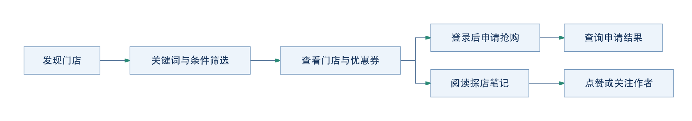

### 阅读路线

| 章节 | 要回答的问题 | 重点源码 |
|---|---|---|
| 1、项目与整体架构 | 项目为谁服务，每个组件负责什么？ | Controller、Service、部署配置 |
| 2、登录与身份隔离 | token 存哪里，怎么确定“我是谁”？ | UserController、拦截器、MerchantServiceImpl |
| 3、门店详情缓存 | 查不到与没缓存有什么区别？ | ShopServiceImpl、CacheClient |
| 4、ES 门店发现 | 中文、拼音、价格和距离怎么组合？ | ShopSearchServiceImpl、ShopDoc |
| 5、秒杀受理与状态 | 返回编号以后，到底处理到哪一步了？ | VoucherOrderServiceImpl、SeckillRequest |
| 6、Lua 幂等预占 | 如何只扣一次，又能识别不确定结果？ | seckill-reserve.lua、SeckillReservationService |
| 7、MQ 落单与补偿 | 消息重复、发送超时和应用退出怎么办？ | SeckillRequestService、mq 包 |
| 8、商户修改与 Outbox | 如何避免门店改了、ES 通知丢了？ | ShopSyncEventMapper、ShopSyncPublisher |
| 9、笔记与轻社交 | 为什么保留点赞，却移除 Feed？ | BlogServiceImpl、FollowServiceImpl |
| 10、商户与平台后台 | 怎样防止商户修改别人的店？ | admin/platform Controller |
| 11、运行与验证 | 本机怎样启动，怎样判断问题在哪？ | deploy、scripts、测试目录 |
| 12、项目复盘 | 哪些已经实现，接下来值得做什么？ | 验收记录与源码阅读索引 |

---

## 1、先认识我们的项目

### 1.1、项目解决什么问题

HMDP 是一个围绕线下门店的发现、探店和优惠券抢购系统。用户可以按店名、商圈、拼音或首字母找店，也可以结合分类、人均价格、评分和距离缩小范围；找到门店后，继续查看优惠券和探店笔记。

商户需要维护自己店铺的信息，并发布店铺优惠券。平台负责查询商户账号、启用或停用商户。三类使用者进入同一个后端，但各自携带独立的身份，权限由服务端控制。

| 使用者 | 主要能力 | 典型页面 |
|---|---|---|
| 消费者 | 找店、浏览笔记、登录、抢购、点赞、关注作者 | 首页、商户列表、门店详情、笔记详情 |
| 商户 | 登录、查询和编辑自己的店铺、发布券 | 商户后台 |
| 平台 | 登录、分页查询商户、管理账号状态 | 平台后台 |


*图 1-1：本机页面截图。页面中的门店、笔记和图片来自当前演示环境；不将演示数据量作为系统容量。*

### 1.2、从课程项目到当前项目，改变了什么

原课程按 Redis 数据结构组织案例，非常适合入门。我们的改造更关注一条真实业务链，以及应用崩溃、消息重复、搜索数据滞后时如何继续处理。

| 课程中的主题 | 当前项目的处理 |
|---|---|
| Redis 登录与缓存 | 保留；补充商户、平台身份与写权限 |
| 秒杀异步队列 | 当前主路径使用持久化申请 + RocketMQ，不再用 Redis Stream 落单 |
| 附近商户与 GEO | 附近、分类、组合筛选统一进入 ES |
| 探店笔记与点赞 | 保留，并明确作者身份、字段白名单与点赞时间顺序 |
| 关注、共同关注与 Feed | 保留关注作者与作者列表，移除共同关注和粉丝收件箱 |
| 签到、UV | 当前业务没有保留对应功能入口 |
| 门店变更同步 ES | 从内存异步事件改为 Outbox + MQ，并补上版本保护 |

这里的裁剪有一个简单依据：一个功能没有明确用户场景，就不为展示中间件而长期维护它。例如，作者关注列表足以承接“以后再看这个作者”的需求，当前没有必要同时建设粉丝动态收件箱。

### 1.3、整体架构怎么读

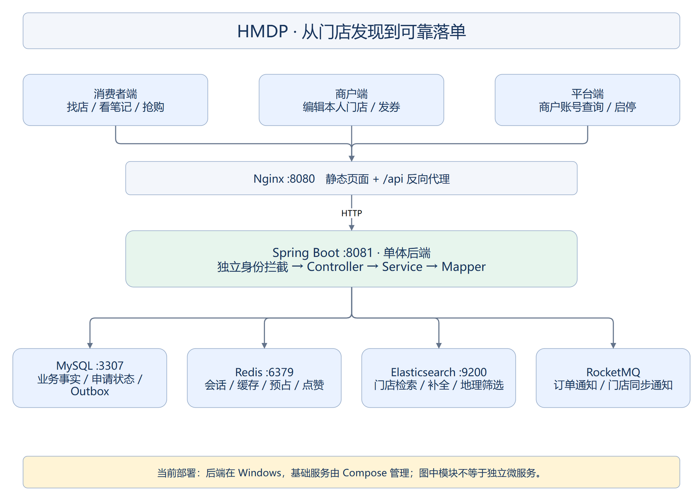

从上往下看这张图：浏览器访问 Nginx，Nginx 返回静态页面，并把 API 请求转给 Spring Boot。后端按照不同业务访问 MySQL、Redis、ES 或 MQ。

**这是一套单体后端。** 图上的登录、检索、抢购、商户管理是业务模块，并不是各自独立部署的微服务。当前基础设施由一个 Compose 项目管理，后端在 Windows 上运行。

| 组件 | 在本项目中的职责 | 不能混淆的地方 |
|---|---|---|
| MySQL | 门店、用户、笔记、券、订单、申请状态和待发送事件 | 业务状态的权威来源 |
| Redis | 登录会话、门店详情缓存、秒杀预占、点赞成员 | 缓存与预占凭据不是最终订单 |
| Elasticsearch | 门店检索、拼音补全、组合过滤、距离排序和统计 | 搜索副本会经历同步和刷新延迟 |
| RocketMQ | 传递下单通知、门店同步通知，失败重试 | Broker 收到消息不代表业务已经完成 |
| Nginx | 静态资源与 API 反向代理 | 当前只配置一个后端，未建设应用集群 |

**想一想：** 如果 ES 暂时停止，门店数据库是否还存在？答案是存在。ES 是可重新构建的检索副本，所以业务写入先落 MySQL，而不是反过来把 ES 当作门店主库。

---

## 2、登录：先识别身份，再决定能不能操作

### 2.1、消费者登录的实际流程

消费者使用手机号和验证码登录。`POST /user/code` 校验手机号，生成验证码，存入 Redis；当前是教学短信模拟，验证码输出到本机控制台，没有对接真实短信供应商。

登录时，服务端比对 Redis 中的验证码，查询用户；手机号首次出现时创建用户。随后签发随机 token，把脱敏后的 `UserDTO` 存入 Redis Hash。

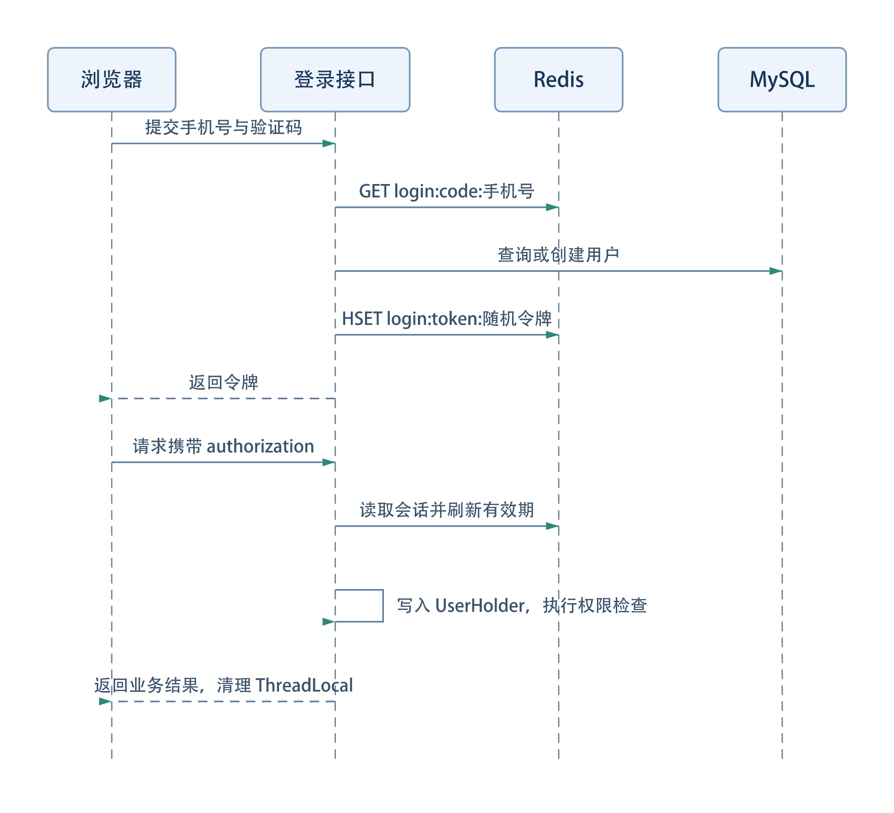

源码入口：[UserController.java](../src/main/java/com/hmdp/controller/user/UserController.java)、[RefreshTokenInterceptor.java](../src/main/java/com/hmdp/interceptor/RefreshTokenInterceptor.java)。

### 2.2、为什么 token 对应 Redis Hash

token 是客户端下一次请求时携带的随机令牌，Redis Hash 保存的是服务端需要的身份信息。浏览器把令牌放进 `authorization` 请求头，服务器用它查会话。

```text
login:code:<手机号>       String，保存短期验证码
login:token:<随机令牌>    Hash，保存消费者 UserDTO
login:merchant:<令牌>     String，保存商户 ID 与会话版本
login:admin:<令牌>        String，保存平台账号 ID
```

同一用户可以有多个会话，所以退出登录时删除的是当前令牌对应的 Key，而不是扫描并删除这个用户的全部登录信息。

**为什么先转成 UserDTO？** 用户实体可能包含手机号等字段，会话和公开资料只需要 ID、昵称、头像。先转换再存储，减少无关数据沿请求链流转。

### 2.3、两个消费者拦截器分别做什么

`RefreshTokenInterceptor` 排在前面：如果请求有有效 token，就识别身份、存入 `UserHolder`，并刷新会话期限；没有有效 token 仍然放行。

`LoginInterceptor` 排在后面：对于需要登录的接口，检查 `UserHolder` 中是否有用户；没有则拒绝。门店查询和公开笔记允许游客浏览，发布、点赞、关注等操作需要登录。

身份识别与访问控制分开后，公开页面也能知道“当前阅读者是否已经点赞”，同时不会强迫所有游客先登录。

**源码摘录：识别身份后刷新会话。**

> 源码摘录：[RefreshTokenInterceptor.java](../src/main/java/com/hmdp/interceptor/RefreshTokenInterceptor.java)，第 51—56 行；以下为方法内片段或原声明。

```text
        //4.把map转为UserDTO（脱敏用户对象）
        UserDTO userDTO = BeanUtil.fillBeanWithMap(userMap, new UserDTO(), false);
        //5.保存到ThreadLocal（业务代码可通过 UserHolder.getUser() 拿到）
        UserHolder.saveUser(userDTO);
        //6.刷新token有效期：每次有请求就续期（滑动过期，活跃用户不过期）
        stringRedisTemplate.expire(key,RedisConstants.LOGIN_USER_TTL, TimeUnit.MINUTES);
```

线程池中的线程会被复用，因此 `afterCompletion()` 必须清理 `UserHolder`。ThreadLocal 是当前请求线程的临时身份容器，不是持久会话仓库。

### 2.4、有效期要对照代码看单位

当前 `LOGIN_CODE_TTL=2`，验证码按分钟保存。消费者 `LOGIN_USER_TTL=36000`，登录签发和请求续期同样按 `TimeUnit.MINUTES` 使用，换算约 25 天。它不是“36000 秒”。商户和平台会话则固定为两小时，不采用消费者的滑动续期策略。

这里列的是当前实现，方便学习和核对；修改会话期限时，应同时检查常量和调用处的单位。

### 2.5、商户、平台为什么不能复用消费者身份

能浏览门店的消费者，并不天然拥有店铺编辑权。项目采用三个 Redis Key 前缀、独立拦截器和独立 Holder；商户 token 进入 `/admin/**`，平台 token 进入 `/platform/**`，消费者 token 不承担这两种身份。

商户登录使用 BCrypt 比对密码哈希。每次认证还会读取数据库中的启用状态及会话版本；停用商户时，状态修改和 `session_version` 递增在同一条 SQL 内完成。再次启用后，旧版本令牌仍然失效，不会随着账号解封重新可用。

**本章自测：** 为什么“没带 token”不应该在第一个拦截器直接报错？因为有些接口允许匿名读取，是否强制登录由后面的访问控制决定。

---

## 3、门店详情缓存：先分清三种缓存结果

### 3.1、为什么详情页仍然读 Redis + MySQL

ES 搜索返回的是检索结果，而详情页需要按门店 ID 读取详情。当前 `GET /shop/{id}` 进入 `ShopServiceImpl.queryById()`，使用 `CacheClient.queryWithPassThrough()`。

这样列表发现与详情读取各有职责：ES 擅长多条件检索，Redis 擅长重复读取同一个门店，MySQL 保存原始业务数据。

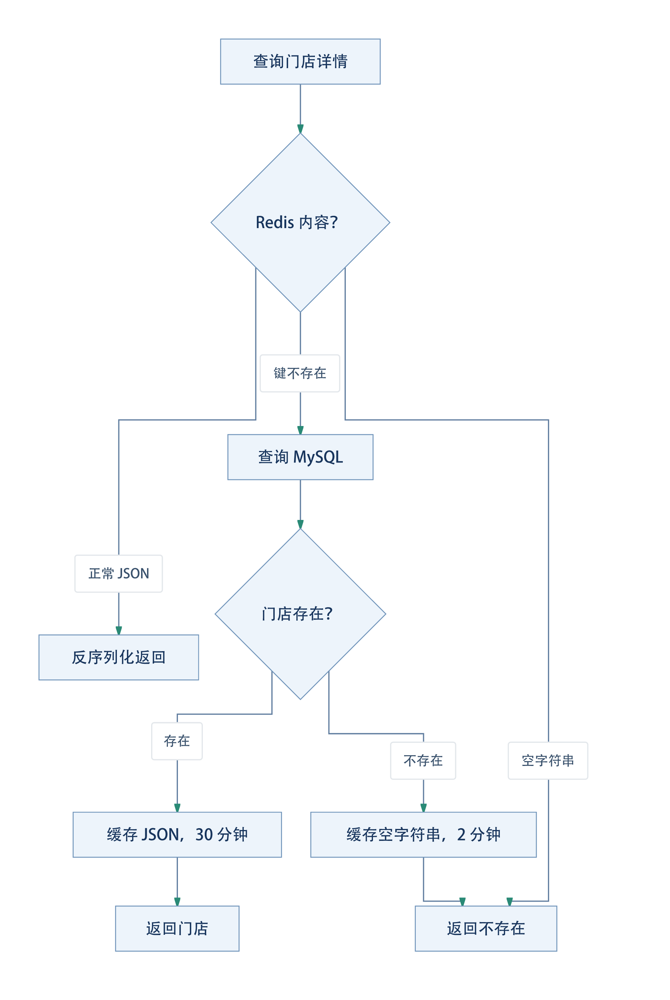

### 3.2、null 和空字符串不是一回事

| Redis 返回值 | 表示什么 | 下一步 |
|---|---|---|
| 正常 JSON | 有效的门店缓存 | 反序列化返回 |
| 空字符串 `""` | 上次查库确认不存在 | 直接返回不存在 |
| `null` | Key 没有缓存 | 查询 MySQL |

查不存在的门店时，如果什么都不缓存，同一个不存在的 ID 每次都会穿过 Redis 打到 MySQL。项目将“不存在”也缓存两分钟，用较短期限挡住重复回源。

### 3.3、把流程对照到代码

源码入口：[CacheClient.java](../src/main/java/com/hmdp/utils/CacheClient.java)。

> 源码摘录：[CacheClient.java](../src/main/java/com/hmdp/utils/CacheClient.java)，第 65—87 行；以下为方法内片段或原声明。

```text
        String key = keyPrefix + id;
        // 1.从redis查询商铺缓存
        String json = stringRedisTemplate.opsForValue().get(key);
        // 2.判断是否存在：非空串 = 命中了正常数据
        if (StrUtil.isNotBlank(json)) {
            // 3.存在，直接反序列化返回
            return JSONUtil.toBean(json, type);
        }
        // 命中「空串」= 之前查过且确认不存在，直接返回 null，不再打库（防穿透）
        if (json != null) {
            return null;
        }

        // 4.缓存完全 miss，查数据库
        R r = dbFallback.apply(id);
        // 5.数据库也没有：写入空值缓存（TTL 较短），下次命中空值直接返回
        if (r == null) {
            stringRedisTemplate.opsForValue().set(key, "", RedisConstants.CACHE_NULL_TTL, TimeUnit.MINUTES);
            return null;
        }
        // 6.数据库有：写入正常缓存并返回
        this.set(key, r, time, unit);
        return r;
```

正常门店 JSON 的缓存 TTL 是 30 分钟，空值缓存 TTL 是 2 分钟。两个期限来自 `RedisConstants`，调用处明确按分钟传入。

**注意“空字符串命中”的位置：** 它必须放在正常 JSON 之后、查数据库之前。否则会把已经缓存的“不存在”再次当作缓存未命中。

### 3.4、当前启用的是哪一种策略

工具类还保留了互斥锁重建与逻辑过期方法，但 `queryById()` 当前调用的是空值缓存路径。不能因为工具类里存在逻辑过期代码，就说所有门店详情已经启用了热点异步重建。

| 策略 | 适合说明的场景 | 当前状态 |
|---|---|---|
| 空值缓存 | 反复查询不存在的门店 | 详情主路径启用 |
| 互斥锁重建 | 热点缓存失效时控制回源 | 工具类保留，可选方案 |
| 逻辑过期 | 接受短期旧值，后台重建热点 | 工具类保留，需要预热 |

缓存穿透、热点击穿和大量 Key 同时失效，是三个不同的问题。空值缓存解决的是“不存在的 ID 反复查”，不会自动解决所有热点并发回源。

### 3.5、门店编辑后为什么提交后删缓存

假设先删缓存，再更新数据库：删除与提交之间，其他请求可能查到旧数据库值并重新缓存。当前项目把删除操作放到事务提交后的事件监听器中，正常请求返回前已经尝试失效旧详情缓存。

```text
数据库事务内：更新门店 + 写入 Outbox + 发布缓存事件
事务提交后：删除 cache:shop:<shopId>
下一次详情读取：缓存未命中 → 从数据库读取新值并回填
```

Redis 删除失败时记录错误，不会倒转已经提交的数据库事务。ES 的可靠同步由独立的 Outbox/MQ 路线承担，第 8 章展开。

**本章自测：** 能否把“数据库提交后删缓存”说成数据库与 Redis 强一致？不能。它规定了正常路径的执行顺序，进程退出、Redis 故障和并发回填仍需按实际场景处理。

---

## 4、ES 门店发现：一个查询承接多个条件

### 4.1、为什么统一分类、附近与组合检索

用户可能同时提出这样的需求：找火锅店、人均 50 到 100 元、评分至少 4 分、距离参考位置 3 公里以内，并按距离排序。

如果分类走 MySQL、附近走 Redis GEO、关键词走 ES，那么每增加一个组合条件，都要协调多套分页与统计口径。当前项目让分类页、附近页和搜索页统一调用 `/shop/search`；数据库按名称查询的 `/shop/of/name` 只用于发布笔记时选择关联门店。

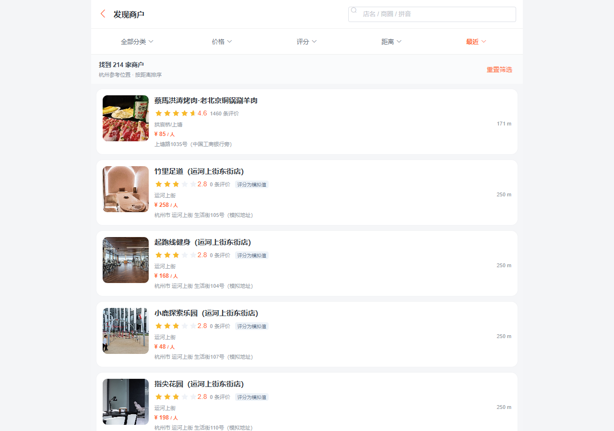

*图 4-1：当前商户发现页。页面支持店名、商圈、拼音与筛选条件组合。*

### 4.2、先准备适合搜索的文档

MySQL 的 `Shop` 是业务实体，ES 的 `ShopDoc` 是搜索文档。转换时保留门店 ID、名称、商圈、地址、价格、评分和图片等信息，并计算名称全拼、名称首字母、地理位置和补全候选词。

| 字段 | ES 类型 | 本项目用途 |
|---|---|---|
| name / area / address | text + IK | 中文关键词检索 |
| namePinyin / nameInitials | keyword | 全拼、首字母前缀查询 |
| typeId | long | 分类精确过滤 |
| avgPrice / score | 数值 | 价格、评分过滤与排序 |
| location | geo_point | 距离过滤、排序和统计 |
| suggestion | completion | 输入联想 |
| images | keyword，关闭索引 | 返回展示地址，不参与查找 |

源码：[ShopDoc.java](../src/main/java/com/hmdp/entity/ShopDoc.java)、[EsConstants.java](../src/main/java/com/hmdp/constants/EsConstants.java)。

拼音与首字母由 Java 转换生成，不是接入了独立的拼音分词插件。中文分词使用 IK，二者负责不同的事情。

### 4.3、must 与 filter 怎么分工

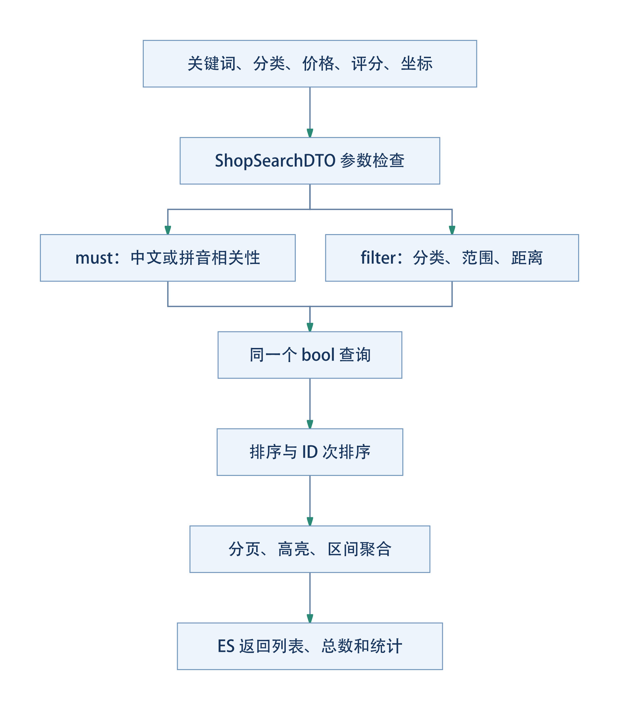

关键词决定“哪家更相关”，所以放入参与打分的条件；分类、价格、评分和距离是“符合或不符合”的硬条件，放入 `filter`。

**精简示意，便于对应源码中的 QueryBuilder：**

```text
bool
 ├─ must：关键词匹配门店名称、商圈、地址或拼音前缀
 ├─ filter：typeId 等于所选分类
 ├─ filter：avgPrice >= minPrice 且 avgPrice < maxPrice
 ├─ filter：score >= minScore × 10
 └─ filter：location 在 radius 米以内
```

例如，`minPrice=50,maxPrice=100` 表示 `[50,100)`，100 元不在这个区间内。数据库评分 45 表示界面上的 4.5 分；构建评分查询时需要乘 10 对齐。

### 4.4、输入 hdl 为什么能找到中文店名

中文片段查询名称、商圈和地址；字母数字片段除了查原文，也查全拼和首字母前缀。混合输入会拆成中文片段和字母数字片段，并要求每个片段都满足相应条件，避免直接丢掉其中一部分。

自动补全走另一条 `/shop/suggest` 接口，使用预先生成的 `suggestion` 候选词。补全只是帮助用户选择搜索词，点击候选后仍然进入真正的搜索查询。

### 4.5、距离、排序与聚合要放在同一套条件下理解

当前支持相关性、距离、价格和评分排序，主排序后再按唯一 ID 次排序，使相同排序值下的次序可重复。它能减少静态数据下分页顺序的不稳定，但数据持续变化时，普通 from/size 分页仍可能产生页间漂移。

距离查询传入点时注意经纬度顺序：某些 ES Java API 使用“纬度 y，经度 x”，不要按变量的书写习惯直接颠倒。

**当前页面使用杭州参考坐标，尚未获取设备实时定位。** “距离我”在讲解时应说成“距离页面参考位置”，直到真正接上浏览器定位并处理授权失败。

价格、评分聚合沿用当前全部查询条件；界面展示的是“当前结果分布”。距离档位使用累计范围，例如 1 公里以内与 3 公里以内存在包含关系，数量不能相加。

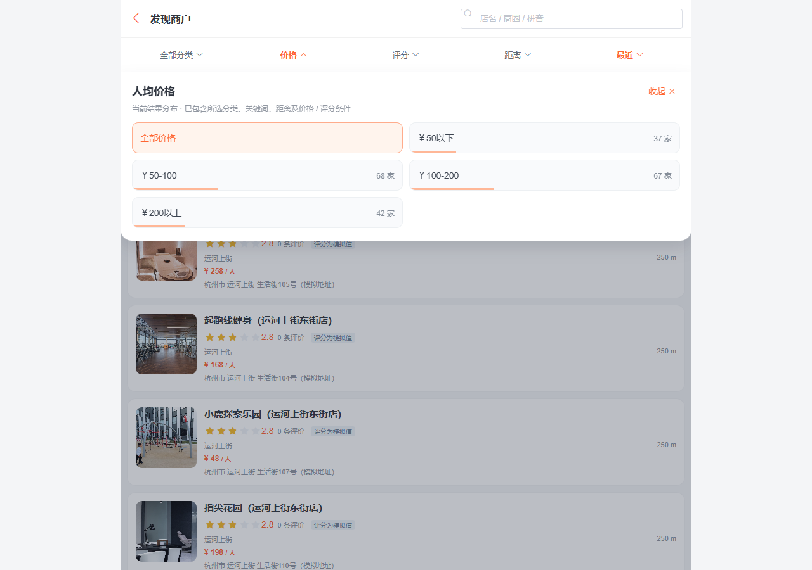

### 4.6、高亮为什么还要转义

后端给命中内容加 `<em>` 标签，前端将其作为 HTML 展示。如果直接把未经转义的门店文本交给 HTML 渲染，文本中的标签可能变成可执行页面内容。

项目使用 `encoder("html")` 转义原文，并在未命中高亮字段时也处理回退文本。高亮是展示效果，不应该改变业务字段的含义或开放任意 HTML。

### 4.7、导入与搜索更新的区别

首次建立索引或维护重建时，从 MySQL 按主键分批导入，每批最多 500 条，并检查 Bulk 每个条目的结果。Bulk 的 HTTP 请求成功，仍可能有部分文档写失败，所以不能只检查 HTTP 状态。

日常改店走单条增量同步；维护重建会校验 Mapping，然后删建索引再导入。当前维护过程存在短暂不可搜窗口，执行时暂停相关写入与在线同步。这里没有引入别名切换、双索引迁移等额外机制。

**本章自测：** 搜索列表和筛选统计能否各自用不同条件查？如果这样做，用户会看到“有 20 家”却找不到对应门店。当前项目让列表和聚合使用同一查询范围。

---

## 5、秒杀：先受理，再让用户查询最终结果

### 5.1、从一张优惠券开始

用户在店铺详情中看到优惠券，点击抢购后，首先检查券是否存在、当前是否在抢购时间窗内，以及当前用户的登录身份。随后执行一次 Redis 只读预检，筛掉明显售罄或重复的请求。

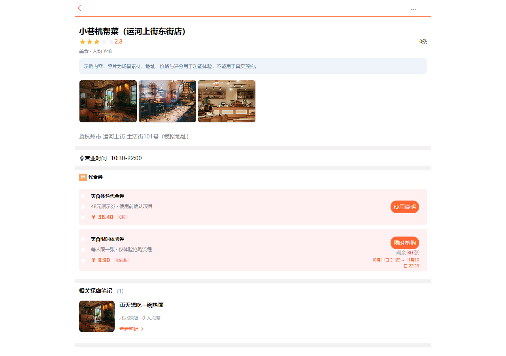

*图 5-1：当前门店详情页。券的有效期和库存取决于演示数据，截图不表示所有券此时都处在可抢购时间窗内。*

预检通过，只代表“看起来可以尝试”，并没有真正预占库存。多个用户可以同时预检通过，正式裁决还要放在后续的原子预占里。

### 5.2、为什么先写申请表

如果顺序是“Redis 已扣库存 → Java 发 MQ”，应用在二者之间退出，Redis 留着预占，消息却可能没有发出去。只在 Java 内存里记住要发什么，重启后也找不回来。

当前项目先提交 `tb_seckill_request`。这条记录保存申请身份、处理状态、预占证据、下次处理时间和截止时间，后台恢复任务可以根据它继续推进。

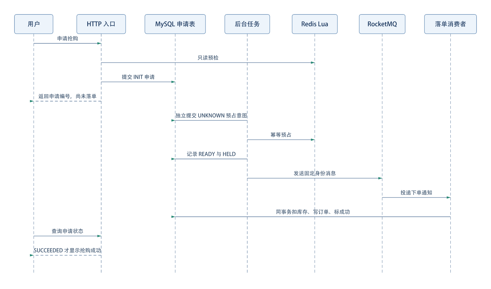

HTTP 正常受理入口不等待 Broker，也不等待落单事务。它返回持久化申请的订单号字符串；前端随后查询结果。数据库成功记录申请后，应用重启仍能找回这件待处理的事。

### 5.3、前端收到编号，应该展示什么

| 请求结果 | 页面应该展示 | 不能直接推断 |
|---|---|---|
| 受理接口返回编号 | 请求已受理，正在处理 | 已抢到券 |
| 查询状态为 INIT / READY | 仍在处理中 | 已写入订单 |
| 查询状态为 SUCCEEDED | 抢购成功，订单已创建 | 已完成真实支付 |
| 查询状态为 CANCELLING | 正在恢复库存 | 已经完成恢复 |
| 查询状态为 FAILED | 展示失败原因 | 可以任意重新使用旧申请 |

对应接口：`POST /voucher-order/seckill/{id}`、`GET /voucher-order/requests/{id}`。按门店找回本人近 10 条申请使用 `GET /voucher-order/requests?shopId=...`；身份从 `UserHolder` 获取，不能由客户端指定另一个用户。

源码：[VoucherOrderServiceImpl.java](../src/main/java/com/hmdp/service/impl/VoucherOrderServiceImpl.java)。

### 5.4、订单号为什么还要转字符串

`RedisIdWorker` 用时间部分和 Redis 每日自增序列组合 long 型 ID：高 32 位放相对时间，低 32 位放序列。

> 源码摘录：[RedisIdWorker.java](../src/main/java/com/hmdp/utils/RedisIdWorker.java)，第 38—51 行；以下为方法内片段或原声明。

```text
    public long nextId(String keyPrefix) {
        // 1.生成时间戳
        LocalDateTime now = LocalDateTime.now();
        long nowSecond = now.toEpochSecond(ZoneOffset.UTC);
        long timestamp = nowSecond - BEGIN_TIMESTAMP;

        // 2.生成序列号
        // 2.1.获取当前日期，精确到天（每天一个key，计数器每天重置）
        String date = now.format(DateTimeFormatter.ofPattern("yyyy:MM:dd"));
        // 2.2.自增长
        long count = stringRedisTemplate.opsForValue().increment("icr:" + keyPrefix + ":" + date);

        // 3.拼接并返回：时间戳左移32位，低32位放序列号
        return timestamp << COUNT_BITS | count;
```

这个 long 在 Java 和 MySQL 中可以存储，但浏览器 JavaScript 的普通数值存在整数精度边界。当前申请查询和受理响应把订单号转成字符串，避免前端传回的编号发生变化。

这里不需要让订单、申请和消息各自生成一个新的业务编号。它们共用 `orderId`，消息事件身份固定为 `CREATE_ORDER:<orderId>`，补发沿用同一个身份。

#### 5.4.1、先纠正一个名称：它不是标准雪花算法

当前 `RedisIdWorker` 的组成是“相对秒数左移 32 位，再拼接 Redis 每日自增序列”。代码没有机器号、数据中心号，也没有每个进程各自维护的毫秒内序列。因此介绍项目时，准确说法是 **Redis 自增序列与时间部分组合的全局 ID**，不直接称为标准 Snowflake。

| 对比项 | 当前 RedisIdWorker | 典型 Snowflake 实现 |
|---|---|---|
| 时间粒度 | 秒 | 通常是毫秒 |
| 序列来源 | Redis 的日 Key，多个实例共享 INCR | 各工作节点维护本地序列 |
| 节点标识 | ID 内没有独立节点位 | 通常划分 worker/datacenter 位 |
| 依赖 | 依赖 Redis 取得序列 | 通常无需每次访问 Redis |
| 回拨处理 | 当前没有显式等待或拒绝逻辑 | 取决于具体实现，可能等待、拒绝或使用逻辑时钟 |

#### 5.4.2、时钟回拨会怎样，为什么不直接等于重复

假设同一天中，先后两次调用读到了相同的相对秒数 T，但 Redis 日计数器从 101 增加到 102：

```text
第一次：(T << 32) | 101
第二次：(T << 32) | 102
```

即使时间部分重复，低位序列仍不同。因此，在**所有实例使用同一份 Redis 计数器、历史计数没有丢失或重置、序列未超出分配位宽**的前提下，单纯时钟回拨不会立即制造重复 ID。

更直接的影响是时间顺序：后生成的 ID 可能因为高位时间变小，在数值上小于先生成的 ID。因此它不是严格单调的时钟，也不应该承担订单最终状态或可靠提交先后的裁决。

| 变化 | 按当前实现分析 |
|---|---|
| 同一天内时间回退，日计数保留 | 序列继续增加，时间排序可能回退 |
| 回退到过去日期，旧日期计数仍保留 | 旧日 Key 的序列继续增加；不因为日期复用就立刻重复 |
| 日计数被删除、重置或恢复到旧值，同时复用旧时间部分 | 可能重新生成历史使用过的组合 |
| 多个互不共享计数的 Redis 各自从头计数 | 多个实例可能生成相同组合 |
| 每日序列超出 32 位 | 当前拼接约定不再成立，不能让高位被序列侵入 |

`nextId()` 中时间和日期取自同一个 `LocalDateTime now`，但这不是“与 Redis 自增共同组成原子操作”。另外，它把本地 `LocalDateTime` 按 UTC 偏移解释为秒数，并没有直接获取 `Instant`；现有统一时区环境下可以理解其相对编号用途，迁移时应统一时区并重新核对时间约定。

**项目讲解要点：** 分清“唯一性”“按时间大致有序”和“严格单调”。这里讲清当前实现及其依赖即可，不为补讲义额外改造一套发号服务。

### 5.5、申请进度与预占证据要分开看

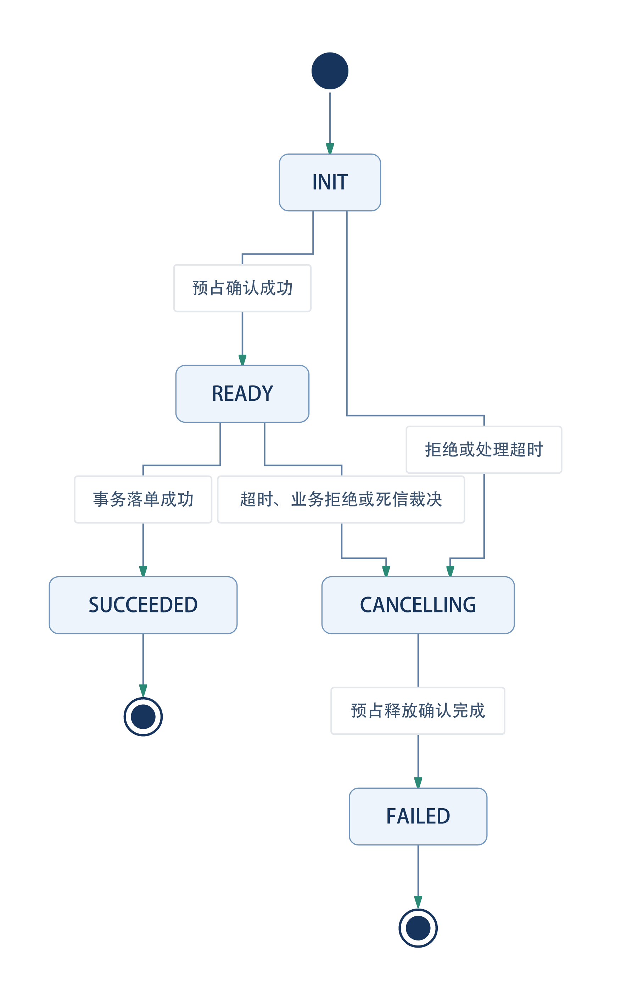

申请进度有五种状态：

| 状态 | 业务含义 | 后续动作 |
|---|---|---|
| INIT | 申请已提交，等待推进或核查预占 | 准备预占 |
| READY | 预占已确认，可以发送和消费 | 发送 MQ、尝试落单 |
| SUCCEEDED | 订单事务已经完成 | 作为成功终态返回 |
| CANCELLING | 已裁决终止，库存释放尚待完成 | 继续幂等补偿 |
| FAILED | 释放或无预占事实已确认，申请结束 | 作为失败终态返回 |

`reservation_state` 则回答另一件事：“我们对 Redis 预占结果掌握了什么证据？”它只有 `NONE`、`UNKNOWN`、`HELD`。

`INIT + UNKNOWN` 并不自相矛盾：申请还没有完成预占确认，但 Redis 那边可能已经执行成功，应用只是没有收到答复。把两个维度拆开，才不会把“未确认”误当成“没做过”。

**本章自测：** 申请处理超时是否等于待支付订单超时关闭？不等于。当前 deadline 限定的是申请推进到落单的期限；支付后的订单生命周期没有在这里实现。

---

## 6、Lua 预占：原子操作之外，还要能识别重试

### 6.1、先认识三类 Redis Key

| Key | 类型 | 保存内容 |
|---|---|---|
| `seckill:stock:<voucherId>` | String | 可预占的库存数量 |
| `seckill:owners:<voucherId>` | Hash | userId → 当前拥有该券资格的 orderId |
| `seckill:request:<orderId>` | String | 本申请 HELD 或 CLOSED 标记 |

库存告诉我们“还有多少”，owners 告诉我们“这份资格属于谁”，申请标记告诉我们“这次申请执行到了哪里”。只检查库存数字，无法判断一次超时调用到底有没有扣成功。

#### 6.1.1、预检 check 与正式 reserve，分别发生在哪一步

源码中的实际文件名是 `seckill-check.lua` 与 `seckill-reserve.lua`。它们虽然都会检查时间、库存或用户归属，但服务的阶段和副作用不同。

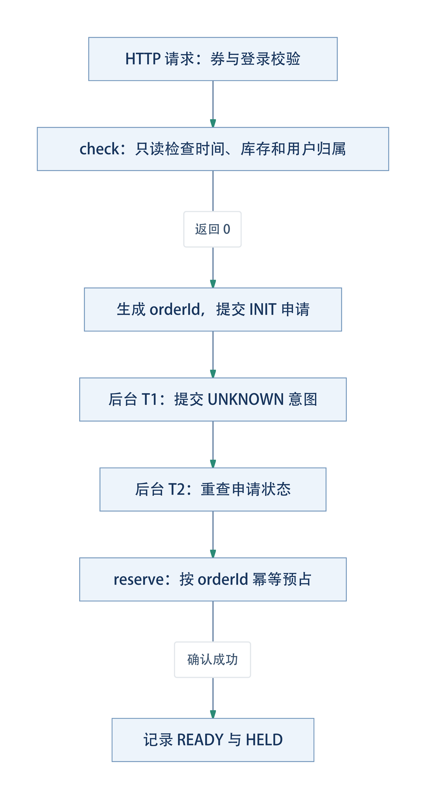

| 对比项 | 只读预检：check | 正式预占：reserve |
|---|---|---|
| 调用时机 | HTTP 受理入口，持久化申请之前 | 后台推进 INIT，UNKNOWN 意图已经提交之后 |
| Java 入口 | `reservation.check(userId, voucher)` | `reservation.reserve(request, voucher, firstAttempt)` |
| 是否有本次申请的 orderId | 预检调用参数不需要 | 需要；作为幂等操作身份 |
| 主要读取 | stock、owners、Redis 服务器时间 | 本次 marker、owners、stock、服务器时间 |
| 是否扣库存 | 不扣 | 只有满足预占条件时扣一次 |
| 是否写归属或申请标记 | 不写 | 写 userId → orderId 与 HELD，或恢复已有凭据 |
| 返回 0 | 此刻可继续提交申请 | 本次预占已执行或已有预占可确认 |
| 核心作用 | 减少明显无效请求写入申请表 | 做真正的资格、库存与重试裁决 |

这里“只读”针对 `seckill-check.lua` 本身。HTTP 入口在调用它之前，可能通过 `initializeInventory()` 修复缺失库存；通过预检后，还会使用 Redis 生成 ID 并写 MySQL 申请。**不能把脚本只读扩大成整个 HTTP 请求完全没有写操作。**

**源码摘录：预检只读取状态，0 表示允许继续受理。**

> 源码摘录：[seckill-check.lua](../src/main/resources/seckill-check.lua)，第 7—25 行。

```text
local now = tonumber(redis.call('time')[1])
if now < tonumber(ARGV[2]) or now > tonumber(ARGV[3]) then
    return 3   --不在活动时间内
end

-- owners 的键是 userId 存在与否，值是本单 orderId；hexists 只问“这个人抢过没”，不关心是哪一单。
if redis.call('hexists', KEYS[2], ARGV[1]) == 1 then
    return 2  --查是否重复下单
end

-- nil 表示键不存在（数据丢失/未初始化），与值为 "0" 的售罄是两回事：前者是系统异常，后者是业务结果。
local stock = redis.call('get', KEYS[1])
if not stock then
    return 5  --库存不存在
end
if tonumber(stock) <= 0 then
    return 1  --库存不足
end
return 0
```

考虑只剩 1 张券的情况：甲先预检读到 1，乙也预检读到 1。两个请求都可以提交申请；随后后台分别预占，只有真正先完成原子预占的申请能拿到最后一份库存。第二个申请在 reserve 阶段得到拒绝结果，再进入终止流程。

因此，不能拿 check 的成功代替 reserve，也不能因为 HTTP 已经检查过，就删除后台的条件检查。两次检查隔着持久化和调度等待，状态可能已经改变。

### 6.2、为什么调用 Redis 前先提交 UNKNOWN

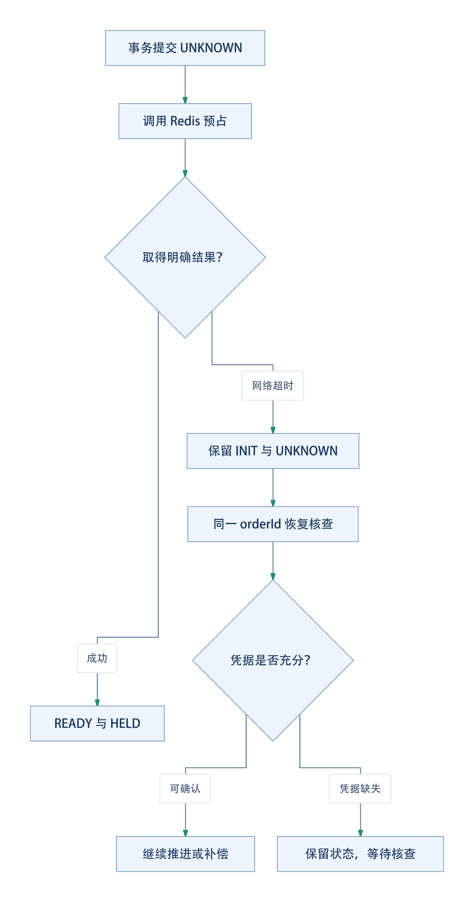

考虑以下故障窗口：Redis 已执行完预占，网络在响应返回前中断。Java 收到了异常，但异常只说明“没有拿到明确答复”，不说明 Redis 没有执行。

`prepare()` 先开启独立事务，将预占意图从 `NONE` 改为 `UNKNOWN` 并提交，然后才调用 Redis。这样即使后面的数据库事务回滚，已提交的 UNKNOWN 也不会消失。

后续用同一个 `orderId` 核查或重试：能找到自己的 HELD 或 owners 凭据，就确认已有预占；凭据不足则保留待核查状态。不能换一个编号重新扣，也不能随手把 UNKNOWN 改成 NONE。

#### 6.2.1、把 prepare 拆成两个数据库事务看

`prepare()` 使用同一个 `TransactionTemplate` 顺序调用两次回调，并为模板设置 `PROPAGATION_REQUIRES_NEW`。**两次回调分别开启独立事务，不是两个回调共享一个事务。**

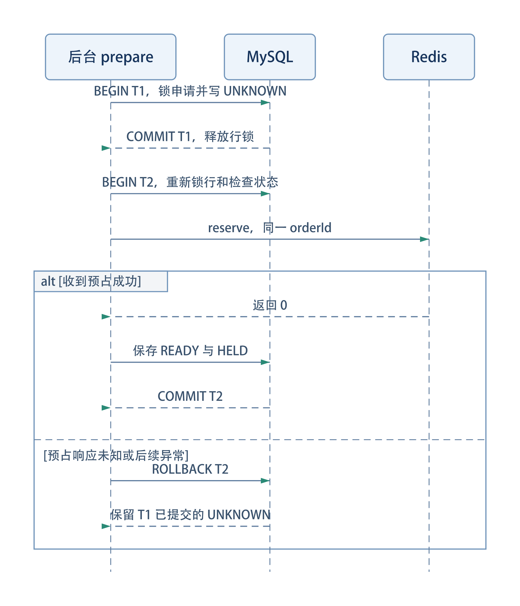

| 阶段 | 数据库事务内做什么 | 什么时候结束 |
|---|---|---|
| T1：留下预占意图 | 锁申请、检查 INIT/期限、首次调用将 NONE 改为 UNKNOWN，并设置下次核查时间 | 第一次 `execute()` 回调正常返回后，提交 T1 并释放行锁 |
| 事务间隙 | 首次意图已经持久化；其他任务有机会更新申请状态 | 等待进入 T2 |
| T2：核查与执行预占 | 重新锁申请、重查状态/期限，必要时调用 reserve，并保存 READY/HELD 或终止结果 | 第二次回调结束时提交；异常时回滚 T2 |

**源码摘录：两次回调的边界。**

> 源码摘录：[SeckillRequestService.java](../src/main/java/com/hmdp/service/SeckillRequestService.java)，第 143—179 行。

```text
    public void prepare(Long orderId) {
        TransactionTemplate transaction = new TransactionTemplate(transactionManager);
        // 开独立事务，保证下面这步“记 UNKNOWN”能自己单独提交，不被外层事务一起卷回滚。
        transaction.setPropagationBehavior(TransactionDefinition.PROPAGATION_REQUIRES_NEW);
        Boolean firstAttempt = transaction.execute(status -> {
            SeckillRequest request = requests.lock(orderId);
            // 不是 INIT 就不处理（可能已经被别的实例推进或终止了）。
            if (request == null || !INIT.equals(request.getState())) {
                return null;
            }
            // 已经超时，直接终止，不再预占。
            if (expired(request)) {
                cancelling(request, TIMEOUT_REASON);
                return null;
            }
            // 关键：先把 NONE 改成 UNKNOWN 并提交。这样哪怕后面扣 Redis 时崩了，
            // 数据库里也留着“可能扣过”的记号，补偿时不会误判成“从没扣过”。
            if (RESERVATION_NONE.equals(request.getReservationState())) {
                request.setReservationState(RESERVATION_UNKNOWN);
                request.setNextSendTime(LocalDateTime.now().plusSeconds(10));
                save(request);
                return true;
            }
            // 租期内可能仍有首次调用在执行，其他实例暂不抢先核查其 Redis 凭据。
            if (request.getNextSendTime() != null
                    && LocalDateTime.now().isBefore(request.getNextSendTime())) {
                return null;
            }
            return false;
        });
        // 只有 firstAttempt 明确是 true/false（不是 null 跳过）才进第二段真正扣库存。
        if (firstAttempt != null) {
            transaction.executeWithoutResult(status -> prepareLocked(orderId, firstAttempt));
        }
    }
```

这里的 `prepareLocked()` 是 private 方法。它不依靠“同类调用时 Spring 自动代理这个 private 方法”开启事务，而是执行在第二次 `executeWithoutResult()` 已经建立的事务回调内。把这一段改写成“调用 private 方法上的 @Transactional”会讲错实际机制。

#### 6.2.2、为什么不能只包一个大事务

用一次具体故障对照：

```text
只有一个事务：
  写 UNKNOWN（尚未提交）→ Redis 预占成功 → 保存后续状态失败 → 整个事务回滚
  结果：Redis 可能已扣，数据库却退回 NONE，丢掉了“可能执行过”的证据。

当前两段事务：
  T1：写 UNKNOWN → 提交
  T2：Redis 预占成功 → 保存后续状态失败 → T2 回滚
  结果：数据库仍保留 T1 已提交的 UNKNOWN，恢复时继续核查已有预占。
```

T1 的目的是先保存“准备尝试，结果可能未知”的事实，不是提前宣布 Redis 执行成功。T2 把确认成功后的状态推进与数据库裁决放在自己的事务中；Redis 的副作用仍不属于这个数据库事务。

这就是两段划分的实际价值：**后续数据库回滚时，保住调用外部组件之前已经提交的恢复线索。** Spring 的 REQUIRES_NEW 语义允许独立物理事务分别提交或回滚；有外层事务时将其挂起，而不是加入外层事务。[Spring 事务传播说明](https://docs.spring.io/spring-framework/reference/data-access/transaction/declarative/tx-propagation.html)

#### 6.2.3、firstAttempt 为什么是 Boolean，而不是 boolean

第一次回调有三种结果，上层按这三种含义决定是否进入第二段：

| 返回值 | 当前调用的含义 | 下一步 |
|---|---|---|
| `true` | 本次从 NONE 写入 UNKNOWN，是首次尝试 | T2 允许按首次规则执行 Lua |
| `false` | 已有 UNKNOWN 且等待期到期，是恢复核查 | T2 用同一 orderId 核查已有证据，不凭空再次扣减 |
| `null` | 申请已转态、超时已处理，或其他首次调用尚在等待期内 | 本轮跳过 T2 |

`firstAttempt ? "1" : "0"` 最终传给 reserve 脚本的 `allowNew` 参数。这个参数限制恢复调用只能确认既有结果，避免凭据消失后又重新扣一份库存。

#### 6.2.4、为什么 T2 还要重新取锁和检查状态

T1 完成后行锁已经释放，T1 与 T2 之间没有一把跨事务的数据库行锁。其他任务可能已把申请改成 CANCELLING，因此 `prepareLocked()` 首先重新锁行并判断状态，不能继续照着 T1 的旧实体执行。

第二段在持有申请行锁时调用 Redis，能串行协调同一申请的预占与终止，但会把 Redis 调用耗时带入数据库锁持有时间。当前先保持可靠性路径清楚；如果将来压测发现锁等待显著，再依据实测决定是否拆短，而不是把这个成本藏起来。

若从外层事务复用 REQUIRES_NEW，还要考虑外层连接挂起、内层连接获取对连接池的占用。当前调度入口没有人为包一层大事务，讲解时无需额外假设存在这种嵌套。[Spring 事务资源说明](https://docs.spring.io/spring-framework/reference/data-access/transaction/declarative/tx-propagation.html)

### 6.3、预占脚本怎样保证重复调用不重复扣减

脚本先检查申请自己的标记。如果已经 HELD，直接返回成功；如果 CLOSED，拒绝迟到调用。然后检查用户的归属：如果 owners 仍指向本 orderId，补齐标记后返回成功；如果指向另一申请，则按首次调用与恢复核查的语义处理。

只有允许首次预占、时间窗有效且库存大于零时，才执行真正扣减。

**源码摘录：真正的三步预占。**

> 源码摘录：[seckill-reserve.lua](../src/main/resources/seckill-reserve.lua)，第 46—49 行；以下为方法内片段或原声明。

```text
redis.call('decr', KEYS[1])
redis.call('hset', KEYS[2], ARGV[1], ARGV[2])
redis.call('set', KEYS[3], 'HELD')
return 0
```

在当前单机 Redis 部署中，同一段 Lua 执行期间不会插入其他 Redis 命令，因此“扣库存、写归属、写标记”可以作为一个不可穿插的执行过程。但这份原子性没有跨越到 MySQL 或 RocketMQ，所以仍然需要申请表和恢复流程。

### 6.4、脚本返回码是业务协议

| 码 | 当前预占脚本含义 | Java 侧处理重点 |
|---|---|---|
| 0 | 预占成功或已确认本次已有预占 | 推进为 READY / HELD |
| 1 | 售罄 | 进入终止流程 |
| 2 | 用户已有其他申请资格 | 进入终止流程 |
| 3 | 不在活动时间窗 | 进入终止流程 |
| 4 | 申请标记已 CLOSED | 不允许复活 |
| 5 | 库存 Key 缺失 | 区分首次明确未扣和恢复中的未知结果 |
| 6 | 恢复核查证据不足 | 保留未知，不重新扣减 |

Java 调用 `RedisTemplate.execute()` 若返回 null，同样按“结果未知”抛出异常，不能用一个默认成功码替代。

### 6.5、库存 Key 丢了，为什么不能直接从数据库回填

假设 MySQL 库存是 10，Redis 已经为在途申请预占 3 份，而这 3 份尚未完成数据库落单。此时 Redis 库存应是 7。若 Redis Key 丢失后直接把 MySQL 的 10 写回，就把在途的 3 份重新放出来了。

当前 `initializeInventory()` 用 Redisson 锁协调初始化，拿锁后再次检查 Key，并检查是否存在 INIT、READY、CANCELLING 申请；有在途申请就停止自动回填，等待核查。确认没有在途申请后，读取最新数据库库存并用 `setIfAbsent` 回填。

这里 Redisson 负责的是**缺失库存初始化的协调**，不是正常消费落单时的一把全局用户锁。阅读旧介绍时尤其要按当前源码核对这一点。

#### 6.5.1、Redisson 这把锁究竟锁什么

当前调用是 `redisson.getLock(SECKILL_INITIALIZE_LOCK + voucherId)`，Key 前缀是 `lock:seckill:initialize:`；临界区覆盖“二次确认 Key → 检查在途申请 → 读取数据库最新库存 → SETNX 回填”。同一张券的多个初始化调用竞争同一把锁，不同券使用不同 Key。

> 源码摘录：[SeckillRequestService.java](../src/main/java/com/hmdp/service/SeckillRequestService.java)，第 87—112 行。

```text
        RLock lock = redisson.getLock(SECKILL_INITIALIZE_LOCK + voucher.getVoucherId());
        lock.lock();
        try {
            // 拿锁后再查一次，防止等锁期间别的实例已经把库存补好了。
            if (Boolean.TRUE.equals(redis.hasKey(key))) {
                return;
            }
            // 查有没有还在推进的申请；有的话数据库里的旧库存数字可能慢半拍，补进去会算错库存。
            Long active = requests.selectCount(new LambdaQueryWrapper<SeckillRequest>()
                    .eq(SeckillRequest::getVoucherId, voucher.getVoucherId())
                    .in(SeckillRequest::getState, INIT, READY, CANCELLING));
            if (active > 0) {
                throw new IllegalStateException("存在处理中申请，库存状态需核查");
            }
            // 以数据库最新库存为准回填，而不是用入口传进来的可能已过期的 voucher。
            SeckillVoucher latest = vouchers.getById(voucher.getVoucherId());
            if (latest == null) {
                throw new IllegalArgumentException("优惠券不存在");
            }
            redis.opsForValue().setIfAbsent(key, latest.getStock().toString());
        } finally {
            lock.unlock();
        }
    }
```

正常落单并没有在这里再加一把 `lock:order:userId`。落单和补偿的同申请串行裁决依靠 MySQL 申请行锁；Redisson 在当前链路中承担的是库存初始化协调。阅读旧项目资料时，应把旧锁职责与现在的代码分开。

#### 6.5.2、普通可重入 RLock 为什么用 Hash

以下按本项目依赖的 **Redisson 3.20.0 普通可重入锁**说明，示意结构为：

```text
Key：lock:seckill:initialize:<voucherId>
类型：Hash
field：<Redisson 客户端 ID>:<线程 ID>
value：当前持有者的重入次数
TTL：锁 Key 的剩余租期
```

首次获取时写入持有者并把计数加到 1；同一持有线程重入时计数增加。释放时先校验持有者，再减少重入计数；完全释放后删除 Key，并发布通知唤醒等待者。获取和释放中的条件检查、计数修改及过期操作由 Lua 组合执行。[该版本 RedissonLock 源码](https://github.com/redisson/redisson/blob/redisson-3.20.0/redisson/src/main/java/org/redisson/RedissonLock.java)

Hash 解决的是持有者识别与可重入计数；自动续期来自客户端安排的续期任务，**不是因为用了 Hash，Redis 就会自己续期**。持有者字段中的客户端 ID 加线程 ID，也不是用户 ID 或订单号。[持有者生成规则](https://github.com/redisson/redisson/blob/redisson-3.20.0/redisson/src/main/java/org/redisson/RedissonBaseLock.java)

#### 6.5.3、lock() 与固定 leaseTime 的区别

项目使用不带显式租期的 `lock.lock()`，并在 finally 中 `unlock()`。在 3.20.0 中，无正数显式 leaseTime 的获取路径会安排 watchdog 续期；有正数显式 leaseTime 时按该租期执行，不走同样的自动续期路径。

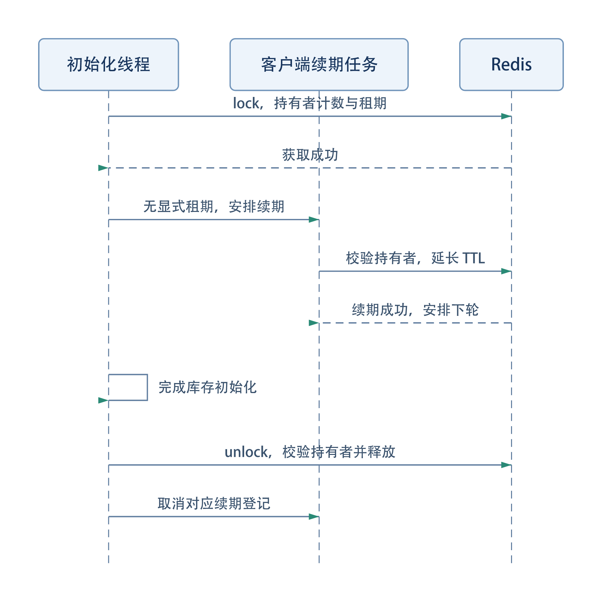

| 调用方式 | 租期行为 | 讲解要点 |
|---|---|---|
| 当前 `lock()` | 获取后由 watchdog 定时延长 | 仍需在 finally 释放 |
| 显式正数 `lock(leaseTime, unit)` | 使用给定租期 | 临界区超过租期时锁可能过期 |
| 当前客户端退出或续期失效 | 最后一次有效续期后，Key 会随 TTL 到期 | 不是进程退出的同一瞬间就一定释放 |

该版本 `lockWatchdogTimeout` 的默认值为 **30000 毫秒**，续期任务按内部租期的约 **1/3** 间隔安排；默认情况下可以理解为约 10 秒发起一次续期，成功时把 TTL 延长回租期长度。这是调度策略，不是精确到秒的实时承诺。实际值取决于运行配置。[默认配置](https://github.com/redisson/redisson/blob/redisson-3.20.0/redisson/src/main/java/org/redisson/config/Config.java)、[续期实现](https://github.com/redisson/redisson/blob/redisson-3.20.0/redisson/src/main/java/org/redisson/RedissonBaseLock.java)

相比只写一条 SET NX EX，当前使用的库还处理了持有者校验、可重入、续期、等待唤醒和原子释放。它减少了我们自行维护锁协议的工作量。若出现长暂停、网络故障或锁到期，业务仍需面对互斥条件变化；watchdog 不会让 MySQL、Redis 与 MQ 自动变成一个事务。

本章只解释当前 RLock 的工作方式，不恢复手写锁、红锁、联锁等未使用的课程分支。

### 6.6、补偿为什么也要一段 Lua

重复补偿不能重复加库存，否则库存可能越补越多。释放脚本先检查 CLOSED 标记，再确认 owners 是否仍属于本 orderId；只有归属明确属于本次申请时，才加回库存并删除自己的归属，最后写 CLOSED。

如果库存 Key 不存在，直接 `INCR` 会凭空新建值为 1 的 Key。当前脚本先检查库存存在，再归还；如果预占证据缺失且数据库仍记为 UNKNOWN/HELD，就返回待核查码。

**本章自测：** 两条 Redis 凭据都不见了，能否据此认定从未扣库存？不能。证据丢失与操作没发生是两件事，申请应保留在可核查的状态。

---

## 7、MQ 落单：发送、消费和补偿各自负责一段

### 7.1、为什么后台扫描申请表

`SeckillRecovery` 有三个独立的调度入口：推进 INIT 预占、发送 READY、处理超期与 CANCELLING 补偿。扫描条件使用状态和时间字段，并为相关查询建立索引，避免每次把整张申请表读进内存。

这里不是另写一套通用任务调度平台。它只推进项目已有的申请状态，处理逻辑仍然由 `SeckillRequestService` 统一裁决。

| 调度入口 | 扫描对象 | 转交给谁 |
|---|---|---|
| preparePending | 到期 INIT | lifecycle.prepare |
| publishPending | 到期 READY | SeckillOrderPublisher |
| recover | 超期 INIT/READY，以及到期 CANCELLING | cancel / compensate |

应用配置了三个调度线程，减少慢发送挤占其他任务的机会。线程数量是配置值，不代表系统经过了吞吐量或延迟指标验证。

### 7.2、领取租期怎样减少重复发送

多个实例可能同时扫描到同一行。扫描只提供候选，能不能发送，要由条件 UPDATE 决定：状态仍是 READY、发送时间已到、尚未超过 deadline，才把下次发送时间推进。

> 源码摘录：[SeckillRequestMapper.java](../src/main/java/com/hmdp/mapper/SeckillRequestMapper.java)，第 39—42 行；以下为方法内片段或原声明。

```text
    @Update("UPDATE tb_seckill_request SET send_attempts=send_attempts+1, "
            + "next_send_time=DATE_ADD(NOW(),INTERVAL 10 SECOND),update_time=NOW() "
            + "WHERE order_id=#{id} AND state='READY' AND next_send_time<=NOW() AND deadline>NOW()")
    int claimSend(@Param("id") Long id);
```

影响行数为 1 才发送，其他实例跳过。这个租期减少并发重复，不承诺完全没有重复：发送成功后应用仍可能在记账前退出，因此消费端必须接受重复通知。

### 7.3、Broker 确认成功以后，为什么还不算落单

发布器 `syncSend()` 等待的是 Broker 的发送结果。正常结果会记录发送时间，并将下次核对时间推后；申请依然是 READY，直到消费者完成事务才变成 SUCCEEDED。

发送结果未知时，只记录错误并退避，**不立即退库存**。否则可能出现“消息其实送到了，消费者正在落单，发布器却把资格放回去”的冲突。

消息中的稳定身份由 `OrderCreateMessage.of(request)` 生成。RocketMQ 的消息 Key 用于查找和跟踪，业务幂等仍由申请状态、订单身份和数据库约束完成。

### 7.4、消费事务真正做哪些事

消费者收到消息后调用带 `@Transactional` 的 `consume()`。完整顺序是：

1. 校验消息是否带订单身份，锁住对应申请行。
2. 校验消息中的订单、用户、券和事件身份是否与申请一致。
3. 已经成功、失败或取消中的申请按状态处理，不重复创建订单。
4. 确认 READY、未超时、Redis 预占凭据仍属于本申请。
5. 检查已有订单和同用户同券订单。
6. 条件扣减 MySQL 库存，插入订单，把申请更新为 SUCCEEDED。

**源码摘录：数据库库存、订单与申请成功在同一个事务里收尾。**

> 源码摘录：[SeckillRequestService.java](../src/main/java/com/hmdp/service/SeckillRequestService.java)，第 332—350 行；以下为方法内片段或原声明。

```text
        boolean deducted = vouchers.lambdaUpdate()
                .eq(SeckillVoucher::getVoucherId, request.getVoucherId())
                .gt(SeckillVoucher::getStock, 0)
                .setSql("stock=stock-1").update();
        if (!deducted) {
            cancelling(request, "数据库库存不足");
            return;
        }
        VoucherOrder order = new VoucherOrder();
        order.setId(request.getOrderId());
        order.setUserId(request.getUserId());
        order.setVoucherId(request.getVoucherId());
        order.setStatus(1);
        order.setPayType(1);
        // 唯一冲突必须向外抛出，让此前扣减的数据库库存随事务一起回滚。
        if (orders.insert(order) != 1) {
            throw new IllegalStateException("订单保存失败");
        }
        succeeded(request);
```

如果插入订单遇到唯一约束冲突，异常向外抛，前面的数据库库存扣减一同回滚。不能把异常吞掉后正常返回，否则 MQ 会认为消息已经处理成功。

### 7.5、一人一券由哪几层承担

| 层次 | 负责什么 |
|---|---|
| Lua owners 归属 | 正式预占时阻止同用户重复拿资格 |
| 申请行锁与状态检查 | 同一申请的落单、终止、补偿串行裁决 |
| 订单主键 | 同一 orderId 不重复创建 |
| `(user_id,voucher_id)` 唯一约束 | 不同申请仍不能为同一用户同一券创建多单 |

这几层不是简单重复校验。它们分别保护不同对象和执行阶段。特别是消息有可能重复，或者同一用户产生了不同申请，最后仍需要数据库约束维护订单事实。

#### 7.5.1、条件更新、版本比较和悲观锁，放在一起看

“乐观锁还是悲观锁”不能只看方法里有没有 `lock` 字样。当前项目同时采用了几类控制手段，它们负责不同的竞争对象。

| 位置 | 实际机制 | 保护什么 | 竞争后的处理 |
|---|---|---|---|
| 数据库扣库存 | `UPDATE ... SET stock=stock-1 WHERE voucher_id=? AND stock>0` | 库存不扣为负数 | 检查影响行数，0 表示未扣成功 |
| 申请状态裁决 | `SELECT ... FOR UPDATE` | 同申请的落单、取消、补偿顺序 | 等待行锁，取得锁后按当前状态处理 |
| MQ 发送领取 | 条件 UPDATE 状态与到期时间 | 当前是否有资格发送 | 影响行数为 0 则跳过 |
| 商户 Outbox 确认 | 条件 UPDATE 带 revision | 旧批次不修改新待办 | 旧版本更新 0 行 |
| ES 增量写入 | `external_gte` 外部版本比较 | 迟到旧数据不覆盖新版 | 旧版本返回 409 |

课程中常把 `stock>0` 的库存扣减称为“乐观锁方案”，是强调把成功条件放进更新语句、按更新结果裁决。**严格按当前代码，它是带条件的原子更新，不是 `WHERE version=旧版本` 再递增版本号的显式版本 CAS。**

同样，它也不是“数据库完全不加锁”：InnoDB 执行 UPDATE 仍会对涉及的记录加锁。区别在于业务层没有先单独 SELECT 锁住库存、再拿着旧值决定如何扣；资格条件和扣减动作放在同一条 SQL 中完成。

**为什么不先查库存再无条件写回？**若甲乙都查到 1，都按旧值各写回 0，就可能创建两笔订单但只体现一次扣减。当前 SQL 在数据库内按当前库存判断和执行 `stock=stock-1`；最后一份库存只能由一个成功更新取得。

**申请为什么又要显式 FOR UPDATE？**因为申请裁决包含读取状态、校验身份、确认预占、查订单、写状态等多个步骤。这里需要串行处理一整段同申请事务，不只是保护一个数值减法。

这两种方式是按业务操作范围组合使用的。不能简单总结为“乐观锁总是快、悲观锁总是慢”；需要看竞争频率、临界区长度、数据库等待以及失败后重试成本。

### 7.6、为什么先 CANCELLING，再 FAILED

需要取消时，先持久化 CANCELLING，表示“终止裁决已经完成，释放还没确认”。后台补偿调用释放 Lua；只有返回明确完成后，才把申请置为 FAILED。

> 源码摘录：[SeckillRequestService.java](../src/main/java/com/hmdp/service/SeckillRequestService.java)，第 278—287 行；以下为方法内片段或原声明。

```text
    @Transactional
    public void compensate(Long orderId) {
        SeckillRequest request = requests.lock(orderId);
        if (request == null || !CANCELLING.equals(request.getState())) {
            return;
        }
        reservation.release(request);
        request.setState(FAILED);
        request.setReservationState(RESERVATION_NONE);
        save(request);
```

这样应用在释放 Redis 后、提交 FAILED 前退出，下一轮仍可重复执行释放：脚本看到 CLOSED，就不会第二次归还库存。

消费异常由 SDK 重试；重试耗尽进入死信，订单死信消费者核对身份后调用 `cancel()`，后续补偿仍由持久状态驱动。它不会在死信监听器里直接“无条件加库存”。

### 7.7、用故障场景检查设计是否闭合

| 故障位置 | 留下的可恢复信息 | 当前处理 |
|---|---|---|
| 写申请后退出 | INIT 申请 | 扫描任务重新推进 |
| Redis 操作响应丢失 | UNKNOWN 意图及可能存在的 Redis 凭据 | 同身份核查 |
| MQ 不可用 | READY 与下次发送时间 | 退避补发 |
| 发送成功但确认记账前退出 | READY，Broker 可能已有消息 | 允许重发，消费幂等 |
| 消费事务中途异常 | 事务回滚，申请未成功 | MQ 重试 |
| 释放 Redis 后退出 | CANCELLING 与 CLOSED | 重复补偿后收尾 |
| 凭据无法判断 | UNKNOWN/HELD 或 CANCELLING | 保留核查入口，不伪造完成 |

这些是恢复规则，不是系统已经做过每一种生产故障演练的声明。当前有哪些验证证据，第 11 章分别列出。

---

## 8、商户修改同步 ES：用 Outbox 留下待办，再用版本保护结果

### 8.1、内存事件为什么不够

原实现使用提交后事件异步调用 ES。它能避免数据库回滚后仍把未提交数据写出去，但应用在事务提交后、异步执行前退出时，内存任务会丢失。

当前实现将“这家店需要同步”的事实写入 `tb_shop_sync_event`，与门店变更放在同一数据库事务内。事务回滚时两者一起回滚，事务提交后事件可在应用重启时继续扫描。

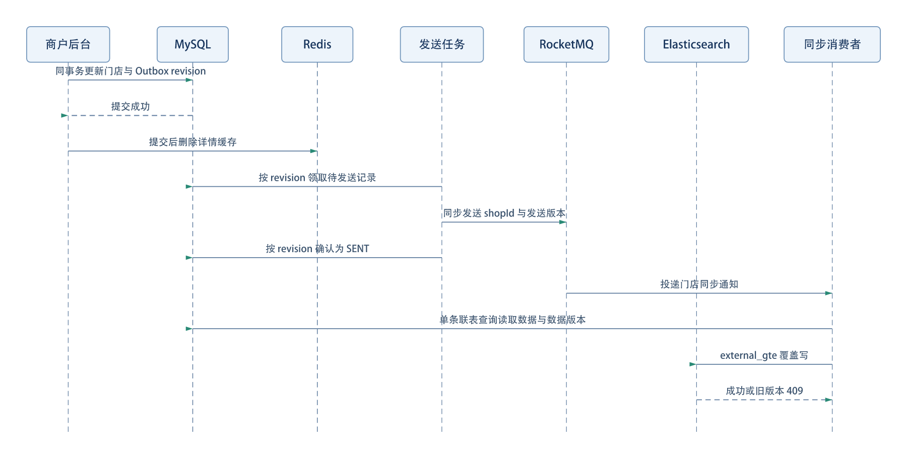

Redis 失效仍由提交后事件处理，ES 同步使用 Outbox + MQ。两个步骤服务不同目标，没有把删除详情缓存也迁移到消息队列。

### 8.2、为什么一商户只保留一条记录

商户连续编辑名称、地址和营业时间，搜索副本最终需要的是完整最新门店数据，不必逐条回放每一次编辑快照。因此主键使用 `shop_id`，重复写入时重置为 PENDING，并递增 `revision`。

| 字段 | 含义 |
|---|---|
| shop_id | 门店 ID，也是 Outbox 主键 |
| state | PENDING 待发送 / SENT 已发送 |
| revision | 随门店写事务递增的同步版本 |
| next_send_time | 领取租期与失败退避时间 |
| last_error | 发送或死信核查的错误信息 |

事件行上的版本需要持久保留，不能单独清空 Outbox 后继续沿用旧 ES 索引版本。当前不引入事件历史归档或审计回放平台。

### 8.3、发送确认为什么必须带 revision

设版本 V 的发送尚未确认，商户又提交了 V+1。此时同一行已经代表新的待同步任务。如果旧发送只按 `shop_id` 把 PENDING 改为 SENT，就会抹掉 V+1 的待办。

修复后，领取、成功确认、发送失败退避都带本次版本条件。旧任务完成时影响行数为 0，就不会触碰新版本。

> 源码摘录：[ShopSyncEventMapper.java](../src/main/java/com/hmdp/mapper/ShopSyncEventMapper.java)，第 33—35 行；以下为方法内片段或原声明。

```text
    @Update("UPDATE tb_shop_sync_event SET state='SENT',last_error=NULL,update_time=NOW() "
            + "WHERE shop_id=#{id} AND state='PENDING' AND revision=#{revision}")
    int sent(@Param("id") Long id, @Param("revision") Long revision);
```

注意，`SENT` 只表示这次通知已由 Broker 确认接收。ES 是否完成同步还要看消费与实际文档，不能把发出状态当作搜索结果状态。

### 8.4、每次重读 MySQL，为什么仍可能写旧

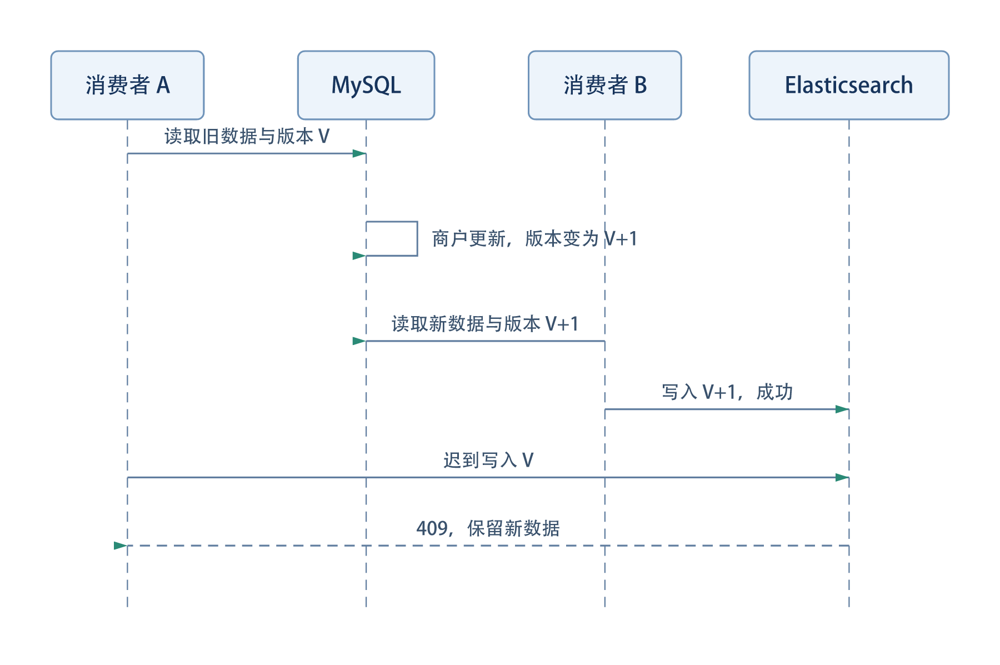

消费者 A 先查到旧数据，但发往 ES 的请求慢；商户更新后，消费者 B 查到新数据并先写成功；随后 A 的旧请求到达，就可能把新值覆盖回去。

所以项目通过**一条联表查询**读取门店完整数据和对应版本，再把这个版本传给 ES。不能先取数据，隔一会儿再查新版本；也不能把消息里旧发送批次的版本套到刚读出的新数据上。

> 源码摘录：[ShopSyncEventMapper.java](../src/main/java/com/hmdp/mapper/ShopSyncEventMapper.java)，第 49—51 行；以下为方法内片段或原声明。

```text
    @Select("SELECT s.*,COALESCE(e.revision,1000000000000) AS sync_revision "
            + "FROM tb_shop s LEFT JOIN tb_shop_sync_event e ON e.shop_id=s.id WHERE s.id=#{id}")
    Shop shopForSync(@Param("id") Long id);
```

版本在现有 Outbox 行递增，商户表没有新增版本列。`Shop.syncRevision` 是联表结果承载字段，标记 `exist=false`，不作为商户表字段，也不输出到接口。

### 8.5、external_gte 的处理规则

ES 普通索引写入按请求到达顺序覆盖。增量同步现在使用 `external_gte`：传入版本不小于当前版本时允许写入；更旧的版本产生 409 冲突。

> 源码摘录：[ShopSearchServiceImpl.java](../src/main/java/com/hmdp/service/impl/ShopSearchServiceImpl.java)，第 340—353 行；以下为方法内片段或原声明。

```text
        IndexRequest request = new IndexRequest(EsConstants.SHOP_INDEX)
                .id(shopId.toString())
                .source(JSONUtil.toJsonStr(doc), XContentType.JSON)
                .version(shop.getSyncRevision()).versionType(VersionType.EXTERNAL_GTE);
        // ⑤ 真正执行写入（全量覆盖写）
        try {
            client.index(request, RequestOptions.DEFAULT);
        } catch (ElasticsearchStatusException error) {
            // 同版本重试由 external_gte 接受；旧版本返回 409 表示新数据已在 ES，直接确认。
            if (error.status() != RestStatus.CONFLICT) {
                throw error;
            }
        }
    }
```

同版本对应的是同一次已提交门店快照，所以可以重复写。旧版本 409 表示 ES 已经拥有更新版本，本次消息可以结束；其他失败继续抛出，让 MQ 重试。

为兼容已有 ES 文档的小整数内部版本，升级列使用高位起点；无事件的历史门店读取基线版本，第一笔事件版本高于基线。它是本项目的迁移约定，不是“时间戳越大越安全”的通用技巧。

### 8.6、死信怎样保留人工处理入口

门店同步与订单补偿不同：同步失败没有库存需要归还。消费重试耗尽后，死信消费者记录 `last_error` 并输出核查日志。这个写错误的 SQL 允许匹配 SENT，但必须限定消息对应的 revision，防止旧死信覆盖新更新的记录。

确认 ES/MQ 恢复后，维护人员按已核查的商户与版本，把状态重置为 PENDING 重新发送。重放不改门店数据，因此不额外递增版本。当前这里没有自动无限重放死信。

对应实现：[ShopSyncEventMapper.java](../src/main/java/com/hmdp/mapper/ShopSyncEventMapper.java)、[ShopSyncPublisher.java](../src/main/java/com/hmdp/mq/ShopSyncPublisher.java)、[ShopSyncConsumer.java](../src/main/java/com/hmdp/mq/ShopSyncConsumer.java)、[核查与验收说明](shop-sync-verification.md)。

**本章自测：** 同商户更新合并，是否意味着永远只会发一条 MQ 消息？不是。领取前的更新可能合并，发送过程中的新更新仍需要新通知；发送结果未知也允许同版本重复投递。

---

## 9、探店笔记与轻社交：保留用户真正会走的路径

### 9.1、一篇笔记怎样与门店发生联系

用户在门店详情可以阅读关联笔记；发布笔记时，需要选择真实存在的门店。保存前检查标题、正文、图片地址数量与长度，再构造一个新的 `Blog` 实体，只复制允许填写的字段。


作者 ID 来自 `UserHolder`，点赞数和评论数由服务端初始化。不能因为 Controller 收到了一个 Blog 对象，就把客户端传来的 `userId`、`liked` 或 `id` 原样持久化。

> 源码摘录：[BlogServiceImpl.java](../src/main/java/com/hmdp/service/impl/BlogServiceImpl.java)，第 69—72 行；以下为方法内片段或原声明。

```text
        Blog blog = new Blog().setUserId(UserHolder.getUser().getId()).setShopId(input.getShopId())
                .setTitle(input.getTitle().trim()).setContent(input.getContent().trim())
                .setImages(input.getImages()).setLiked(0).setComments(0);
        return save(blog) ? Result.ok(blog.getId()) : Result.fail("发布笔记失败");
```

当前保留了图片上传、内容阅读、门店关联和笔记列表；评论数字段初始为 0，不表示已经实现评论发布与审核功能。上传入口要求登录，图片地址串的校验也不等于完整的图片所有权和内容审查。

#### 9.1.1、上传一张图片，文件和地址分别去哪里

图片上传与发布笔记是两次请求。先上传文件拿到路径，再把选中的图片路径与正文一起提交到 `/blog`。数据库保存的是图片地址串，图片二进制内容保存在本地静态目录。

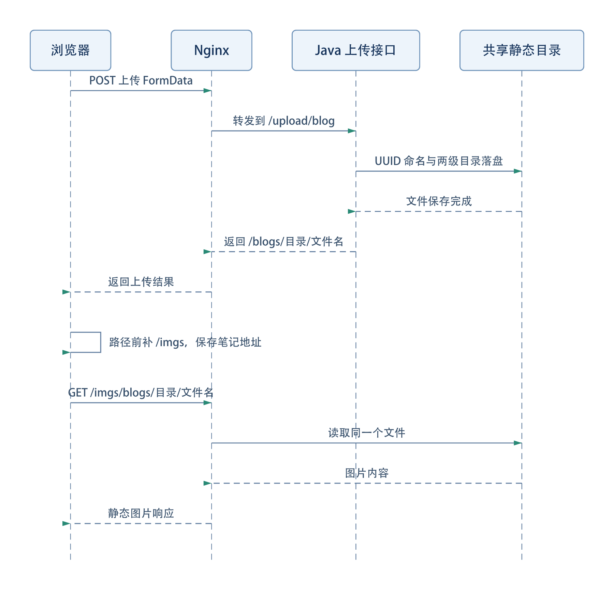

1. `blog-edit.html` 选择文件，构造 `FormData`，字段名为 `file`，请求 `/upload/blog`；该接口经过消费者登录检查。
2. `UploadController` 取原文件后缀，生成 UUID，并用 UUID 的 Hash 低两组 4 位构造两级目录。
3. `MultipartFile.transferTo()` 写入 `SystemConstants.IMAGE_UPLOAD_DIR` 下的目标位置，返回 `/blogs/d1/d2/UUID.后缀`。
4. 前端补上 `/imgs`，得到 `/imgs/blogs/d1/d2/UUID.后缀`，用于预览和最终笔记字段。
5. 浏览器 GET 这个路径时，由 Nginx 从静态目录读取文件；不需要再调用 Java 上传接口。

**源码摘录：UUID 文件名与散列目录。**

> 源码摘录：[UploadController.java](../src/main/java/com/hmdp/controller/user/UploadController.java)，第 42—56 行。

```text
    private String createNewFileName(String originalFilename) {
        // 获取后缀
        String suffix = StrUtil.subAfter(originalFilename, ".", true);
        // 生成目录
        String name = UUID.randomUUID().toString();
        int hash = name.hashCode();
        int d1 = hash & 0xF;
        int d2 = (hash >> 4) & 0xF;
        // 判断目录是否存在
        File dir = new File(SystemConstants.IMAGE_UPLOAD_DIR, StrUtil.format("/blogs/{}/{}", d1, d2));
        if (!dir.exists()) {
            dir.mkdirs();
        }
        // 生成文件名
        return StrUtil.format("/blogs/{}/{}/{}.{}", d1, d2, name, suffix);
```

`d1 = hash & 0xF`、`d2 = (hash >> 4) & 0xF` 的结果各为 0—15，因此有 16 × 16 种两级目录组合。它们由 UUID 的 Hash 决定，不是按用户 ID 分目录，也不是文件内容哈希去重。

文件扩展名来自原文件名；重命名不会自动把图片转码，也不代表已校验文件真实内容。当前 UUID 命名主要减少文件名冲突、避免直接使用客户端原名，散列目录则分散单目录文件数量。

#### 9.1.2、为什么后端说上传成功，Nginx 还可能 404

上传目录按 JVM 的 `user.dir` 拼接为 `src/main/resources/nginx-1.18.0/html/hmdp/imgs`。当前 Nginx 挂载项目里的 `html` 目录，并以其中 `hmdp` 为站点根目录；两端只有指向同一批文件，返回的 URL 才能读到。

| 名称 | 当前含义 |
|---|---|
| Java 落盘目录 | 项目工作目录下的 `.../html/hmdp/imgs` |
| 接口返回路径 | `/blogs/d1/d2/UUID.后缀` |
| 前端拼出的图片 URL | `/imgs/blogs/d1/d2/UUID.后缀` |
| Nginx 文件来源 | 挂载到 `/usr/share/nginx/html` 的宿主机项目目录 |

用 jar 启动时，`user.dir` 是进程工作目录，不自动等于 jar 所在目录。部署后端容器时，需要把上传目录改为明确配置，并让后端可写目录与 Nginx 可读目录共用正确的数据卷；仅把 jar 放进镜像，不会自动共享上传文件。

上传成功、笔记尚未提交或提交失败时，文件可能已存在而没有业务记录引用。当前草稿删图只移除前端列表项，不物理删除文件，也没有文件所有权表和孤立文件清理任务。这解释了当前两次请求的实际边界，后续按存储与部署需求再扩展。

源码：[UploadController](../src/main/java/com/hmdp/controller/user/UploadController.java)、[SystemConstants](../src/main/java/com/hmdp/utils/SystemConstants.java)、[发布页](../src/main/resources/nginx-1.18.0/html/hmdp/blog-edit.html)、[Nginx 配置](../deploy/infra/nginx/nginx.conf)。

### 9.2、点赞为什么使用 ZSet

一个笔记对应 `blog:liked:<blogId>`。其中 member 是用户 ID，score 是点赞时间戳。这样既能查询某人是否点赞，也能按时间取最近点赞的用户。

数据库中保存笔记点赞总数，Redis 中保存点赞成员。操作流程是先读当前状态，再执行增加或移除；真正是否调整数据库计数，以 ZADD 或 ZREM 的实际返回值为准。

> 源码摘录：[BlogServiceImpl.java](../src/main/java/com/hmdp/service/impl/BlogServiceImpl.java)，第 107—124 行；以下为方法内片段或原声明。

```text
        Double score = stringRedisTemplate.opsForZSet().score(key, userId.toString());
        if (score == null) {
            // 3.未点赞 → 点赞：ZSet 加入（score=时间戳），数据库 liked + 1
            // 并发请求都读到未点赞时，只有真正新增member的请求增加计数。
            if (Boolean.TRUE.equals(stringRedisTemplate.opsForZSet()
                    .add(key, userId.toString(), System.currentTimeMillis()))) {
                update().setSql("liked = liked + 1").eq("id", id).update();
            }
        } else {
            // 4.已点赞 → 取消点赞：ZSet 移除，数据库 liked - 1
            Long removed = stringRedisTemplate.opsForZSet().remove(key, userId.toString());
            // ZREM返回实际移除数量：另一个请求已移除时为0，不能再次减计数。
            // GREATEST只防止计数减成负数，不负责修复原有Redis/MySQL差异。
            if (removed != null && removed > 0) {
                update().setSql("liked = GREATEST(liked - 1, 0)").eq("id", id).update();
            }
        }
        return Result.ok();
```

例如两个请求都看到“未点赞”，只有实际新增 member 的那个请求增加计数；取消点赞时，只有实际移除数量大于 0 才扣计数。

但这里仍是一个**切换接口**：顺序请求两次，可能是点赞再取消。Redis 修改与 MySQL 计数也不是一个跨存储事务，所以不能将它宣传成可任意重放或 Exactly-once 的点赞接口。

### 9.3、最近点赞者为什么要恢复数据库返回顺序

从 ZSet 倒序取最近 5 位点赞者，得到的是按时间排序的 ID 列表。但 SQL 的 `WHERE id IN (...)` 不承诺按列表顺序返回。项目用 `ORDER BY FIELD(id,...)` 恢复顺序，最后只返回公开用户信息。

这里的排序对象是“最近点赞者”，不是粉丝数量榜，也不是用户热度榜。

### 9.4、关注只保留 MySQL 这一份关系

当前 `tb_follow` 是关注关系的唯一来源。用户可以关注或取关作者，再通过自己的关注作者列表进入作者页面。没有额外双写 Redis Set，也没有粉丝 Feed 收件箱。

这样做减少了关系双写和动态分发的一致性成本。这个项目的核心仍然是找店、探店与抢购，关注只承担“记住作者”的轻量需求。

### 9.5、首次关注为什么先锁用户，再普通查询

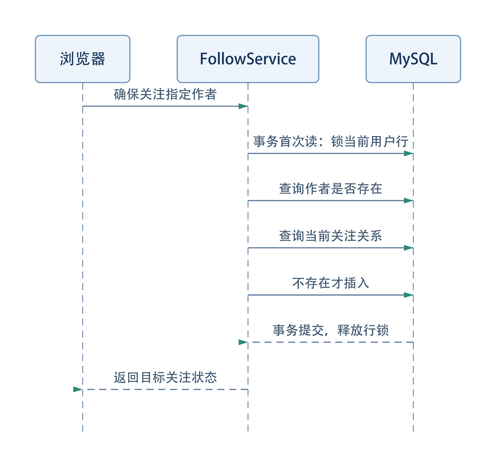

关注关系在首次插入前可能不存在，所以不能指望锁住一条还不存在的关系行。当前实现锁定“当前用户”的主键行，让同一用户的关注修改串行执行。

更细的一点在于 MySQL 的 REPEATABLE READ：如果先普通查询作者，建立了旧快照，再等待用户锁，拿锁后的关系查询可能仍看不到刚才另一事务插入的记录。当前方法把第一次数据库访问留给 `SELECT ... FOR UPDATE`，随后再查询作者与关注关系。

> 源码摘录：[FollowServiceImpl.java](../src/main/java/com/hmdp/service/impl/FollowServiceImpl.java)，第 50—67 行；以下为方法内片段或原声明。

```text
        User current = userService.query().eq("id", userId).last("FOR UPDATE").one();
        if (current == null) {
            return Result.fail("当前用户不存在，请重新登录");
        }
        // 必须在锁之后查询作者，避免REPEATABLE READ在等待锁之前就建立旧Read View。
        if (userService.getById(followUserId) == null) {
            return Result.fail("作者不存在");
        }
        // 两个条件必须同时存在：只修改“当前用户 → 指定作者”，不能按作者ID删掉所有人的关注。
        LambdaQueryWrapper<Follow> relation = new LambdaQueryWrapper<Follow>()
                .eq(Follow::getUserId, userId).eq(Follow::getFollowUserId, followUserId);
        if (Boolean.TRUE.equals(isFollow)) {
            // 持有用户锁时再查关系；前一请求已经提交的关注可以被当前新建快照读到。
            if (count(relation) == 0) {
                Follow follow = new Follow();
                follow.setUserId(userId);
                follow.setFollowUserId(followUserId);
                save(follow);
```

这个约束依赖当前 HTTP 通过事务代理进入该方法，且锁前没有外层事务已经建立的旧快照。如果未来把它复用进其他长事务，应重新检查调用前提。当前没有给 `tb_follow` 新加唯一索引，不能把服务层约束说成所有直接写表程序都会遵守的数据库约束。

### 9.6、公开阅读与登录写入怎样分开

首页笔记、门店笔记、作者公开资料允许匿名访问；本人资料、发布、上传、点赞、关注需要登录。公开资料通过 DTO 或明确的字段白名单返回，不直接序列化完整用户实体。

MVC 白名单没有简单放开 `/blog/**` 或 `/user/**`，而是限定读取路径及数字 ID，防止顺手放开写接口。

**本章自测：** 作者主页公开，能否因此放开 `/user/me`？不能。作者公开资料与当前登录者的个人身份是两种资源。

---

## 10、商户与平台后台：谁能改数据，由服务端决定

### 10.1、商户端的目标是“维护我自己的店”

商户通过独立登录页进入后台，读取自己的店铺信息，再编辑名称、分类、地址、图片、坐标和营业时间等字段。前端表单服务于使用体验，服务端再次校验字段范围和店铺归属。

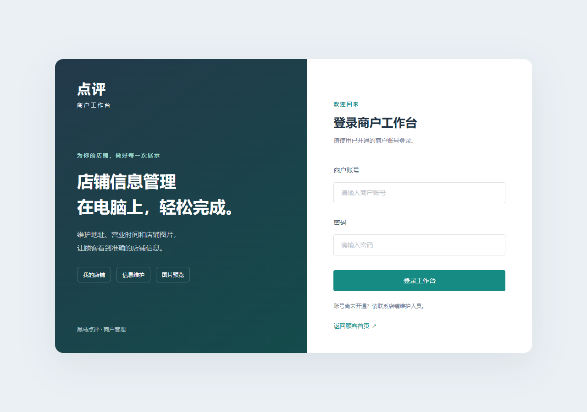

*图 10-1：商户后台登录入口实拍；截图不包含账号、密码或已登录会话。*

关键点是：目标店铺从当前商户身份确定，不相信客户端随意传来的店铺 ID。更新 SQL 同时限定店铺 ID 和 ownerId；编辑请求只允许白名单字段进入更新。

> 源码摘录：[ShopServiceImpl.java](../src/main/java/com/hmdp/service/impl/ShopServiceImpl.java)，第 78—90 行；以下为方法内片段或原声明。

```text
        LambdaUpdateWrapper<Shop> update = new LambdaUpdateWrapper<Shop>()
                .eq(Shop::getId, previous.getId()).eq(Shop::getOwnerId, merchantId)
                .set(Shop::getName, input.getName().trim()).set(Shop::getTypeId, input.getTypeId())
                .set(Shop::getImages, input.getImages().trim()).set(Shop::getArea, trim(input.getArea()))
                .set(Shop::getAddress, input.getAddress().trim()).set(Shop::getX, input.getX())
                .set(Shop::getY, input.getY()).set(Shop::getAvgPrice, input.getAvgPrice())
                .set(Shop::getOpenHours, trim(input.getOpenHours()));
        if (baseMapper.update(null, update) != 1) {
            throw new IllegalStateException("店铺更新数量异常");
        }
        // 两件事：①发内存事件让提交后监听器删 Redis 详情缓存 ②落 Outbox 记录走 MQ 可靠同步 ES。
        eventPublisher.publishEvent(new ShopChangedEvent(previous.getId()));
        shopSyncEventService.record(previous.getId());
```

这条更新与 Outbox 写入在同一事务中。商户看到“保存成功”意味着 MySQL 已提交，Redis 失效已尝试，ES 则等待后台同步和自身刷新后可见。

### 10.2、为什么读编辑表单直接查数据库

商户正在编辑的是权威业务数据。若编辑表单也从消费者详情缓存读取，刚保存的新值可能被旧缓存覆盖回表单。因此 `queryOwnShop()` 直接按 ownerId 查 MySQL，不经过消费者缓存。

消费者详情与后台编辑复用门店表，但不同读取目的可以使用不同路径，不必为了“代码复用”让两种需求承担同一份缓存语义。

### 10.3、发布优惠券与开放写接口

商户发券进入受保护的后台接口。店铺归属由当前商户身份决定，不开放游客修改任意店铺或优惠券的公共写入口。

秒杀券的数据库库存、活动时间窗和 Redis 初始库存需要对应。新增券和开始抢购前，按服务端校验与库存初始化路径准备数据；不能只在前端按钮上写一个库存数字。

### 10.4、平台端管理账号，不代替商户编辑

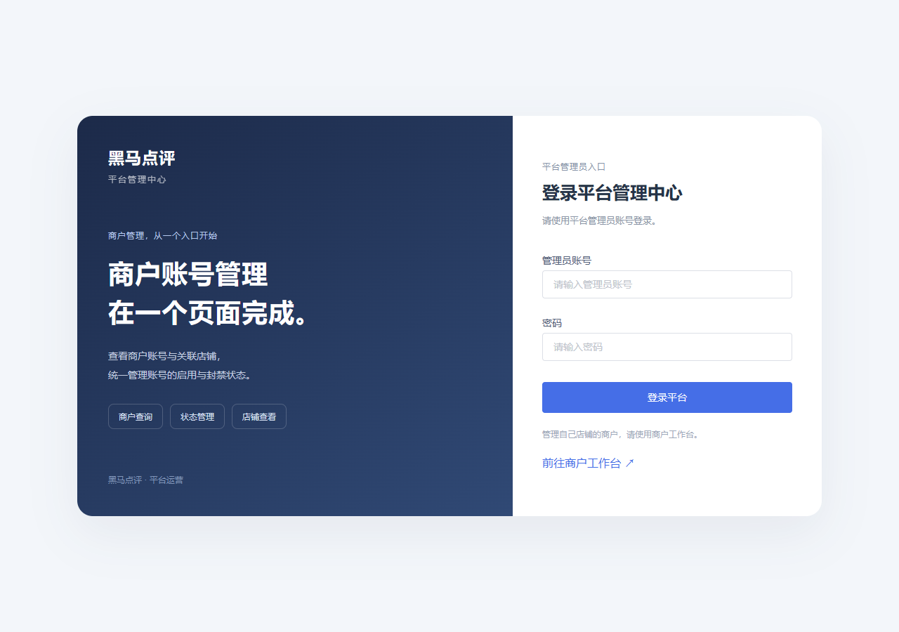

平台可以分页查商户账号，按账号、名称、店名或商圈搜索，并启用、停用账号。店铺编辑继续走商户自己的入口，当前没有扩展成完整 RBAC 权限中心。

平台列表查询先确定匹配范围，再分页，避免“先分页再筛选”造成总数与页码失真。一页内的关联店铺和分类批量查询，减少逐行读取造成的 N+1 查询。

停用操作同时递增商户会话版本，认证时核对该版本，达到撤销旧会话的效果。这个过程不需要扫描 Redis 全部 token。

### 10.5、前端也有自己的状态管理

门店搜索条件变化时，旧请求可能比新请求更晚返回。`shop-search.js` 使用版本标记忽略过时响应，并区分加载中、成功、失败与没有更多内容。

同样，聚合查询失败不能显示成“0 家”；抢购受理不能显示成“已成功”。这些页面状态是业务准确性的一部分，并不是只要接口返回 200 就能忽略的展示细节。

源码阅读：[商户服务](../src/main/java/com/hmdp/service/impl/MerchantServiceImpl.java)、[平台服务](../src/main/java/com/hmdp/service/impl/AdminServiceImpl.java)、[搜索页面逻辑](../src/main/resources/nginx-1.18.0/html/hmdp/js/shop-search.js)。

---

## 11、把项目跑起来，再按层验证

### 11.1、先分清本机部署位置

本机中间件由 `deploy/compose.yaml` 统一管理；Spring Boot 后端在 Windows 上运行。Nginx 在容器中，因此代理宿主机应用时使用 `host.docker.internal:8081`，不能写成容器自己的 `127.0.0.1:8081`。

| 服务 | 本机访问端口 | 说明 |
|---|---|---|
| Nginx | 8080 | 页面和 API 统一入口 |
| Spring Boot | 8081 | Windows 上的后端进程 |
| MySQL | 3307 | 避开本机其他学习项目占用的 3306 |
| Redis | 6379 | 当前 Compose 镜像为 6.2.4 |
| ES | 9200 | 7.17.24，配套 IK |
| MQ NameServer | 9876 | 服务发现入口，不是 Broker 业务端口 |
| MQ Broker | 10911 / 10909 | 消息客户端连接相关端口 |

Compose 中部分镜像使用主版本或滚动标签，例如 MySQL 8.0、Nginx alpine；这里按当前配置说明，不将标签当作永久固定的补丁版本。

### 11.2、建议启动顺序

1. 启动 Docker Desktop，执行项目的 `start-all.bat` 或按部署说明启动 Compose。
2. 确认数据卷和本地配置就绪；新环境按建表、种子数据和后续迁移的顺序初始化。
3. 核对秒杀申请表、订单唯一索引、商户归属及 Outbox 版本列。
4. 创建需要的普通 Topic 和死信 Topic，确认 Broker 地址能从宿主机访问。
5. 运行后端，再打开消费者、商户、平台入口。

```powershell
# 在项目根目录执行；确认 Docker Desktop 已就绪。
docker compose -f deploy/compose.yaml up -d

# 查看容器是否处于预期状态。
docker compose -f deploy/compose.yaml ps

# 本轮已验证过的独立修复包；普通开发也可以在 IDEA 中启动主类。
java -jar target/hmdp-p4-fixed.jar
```

**不要重复启动两个监听 8081 的后端。** `start-all.bat` 启动的是基础服务，不自动保证数据库已执行全部后续迁移，也不自动保证业务 Topic 已创建。

新环境可从 [部署说明](../deploy/README.md)、[MQ 设计](mq-design.md) 和 [商户同步迁移说明](shop-sync-verification.md) 继续操作。本地配置包含连接信息，按模板在本机准备，不把密码复制进讲义。

### 11.3、Outbox 的升级有两个脚本

```text
database/migrations/20261030-shop-sync-outbox.sql    建原 Outbox 表
database/migrations/20261030-shop-sync-revision.sql 增加递增版本列
```

版本列升级脚本是一次性的 ALTER，不应反复执行。本机本轮已完成升级。秒杀相关迁移和唯一约束检查由各自的脚本及启动自检承担，不要拿 Outbox 脚本代替整套数据库初始化。

外部数据卷保持原有命名，绑定挂载的前端目录也需要存在。复制工程时，只复制 Compose 文件而漏掉挂载内容或初始化步骤，并不等于复制了可运行环境。

### 11.4、验证要区分四个层次

| 层次 | 能回答什么 | 典型方式 |
|---|---|---|
| 编译与打包 | Java 类型、依赖和打包配置是否成立 | Maven compile/package |
| 自动测试 | 特定逻辑和回归场景是否成立 | JUnit、Mockito、本地 HTTP 替身 |
| 真实组件验证 | 实际 SQL、ES 版本规则是否如预期 | MySQL 临时表、ES 临时索引 |
| 接口与页面联调 | 用户操作能否走通，展示是否正确 | 浏览器、真实请求、状态核查 |

性能则是另外一层，需要固定机器、数据、并发模型和指标再测试。本文没有将“用了 Redis/MQ”换算成任何 QPS 或吞吐量数字。

### 11.5、本轮有哪些可追溯证据

以下是 2026-10-30 商户同步修复阶段实际留下的记录，并不是重新跑遍全部故障场景后的生产验收：

| 证据 | 结果 | 覆盖范围 |
|---|---|---|
| 商户事务与同步定向测试 | 12 项通过，包含在后续回归中 | 事务写 Outbox、消费异常、死信记录、HLRC 版本写入 |
| MySQL 连接级临时表 | 9 项通过 | 回滚、条件领取、旧确认隔离、死信与版本联表 |
| 真实 ES 临时索引 | 新版成功、旧版 409、同版重试成功 | 外部版本的实际服务行为 |
| 排除一项既有秒杀调度夹具后的回归 | 共 100 项，94 通过、6 默认跳过 | 当前默认可执行的其余回归 |
| 独立修复包 | 打包及包内类检查通过 | `target/hmdp-p4-fixed.jar` |

完整默认测试还有一项 `SeckillSchedulingTest` 的夹具缺少 `VoucherOrderMapper` Bean，测试上下文启动失败，尚未纳入本轮修复。显式维护与集成测试默认跳过，跳过不算已经通过。

本讲义制作阶段启动了修复版后端，公开门店搜索和笔记接口返回正常，并拍摄页面截图；本轮未为截图操作用户密码、商户资料或抢购订单，也未执行索引重建。

### 11.6、遇到报错，先沿请求链找根因

| 看到的现象 | 先核对 | 再往哪里看 |
|---|---|---|
| 页面打开但 API 502 | 8081 是否监听、Nginx 后端地址 | 后端启动日志、容器到宿主机连接 |
| 无路由或找不到 Topic | Topic 是否创建、Broker 是否注册 | NameServer 地址、Broker 对外地址 |
| Outbox 一直 PENDING | 到期时间、领取条件、发送异常 | MQ 路由和 Broker 发送结果 |
| Outbox 已 SENT 但 ES 没更新 | 消费日志、重试、死信、last_error | ES 文档版本及刷新、人工重放 |
| 抢购一直处理中 | 申请 state / reservation_state | 预占凭据、deadline、扫描任务 |
| 申请停在 CANCELLING | 释放脚本返回码和 Redis 归属 | 库存 Key 是否缺失、证据是否矛盾 |
| 搜索有结果但详情不一致 | ES 副本、Redis 详情缓存、MySQL 各自内容 | 商户提交后的删除与同步路径 |

排查时只读取必要字段，不把 token、验证码、密码或完整连接串粘到公开记录里。恢复数据之前，先确认自己看的到底是申请、订单、缓存还是检索副本。

---

## 12、项目复盘：能够讲清楚的设计，才是自己的项目

### 12.1、用一条完整故事介绍它

可以这样开始：

> 这个项目从黑马点评课程工程改造，围绕门店发现、优惠券抢购和探店笔记组织功能。消费者的分类、附近和组合搜索统一走 ES，详情走 Redis 缓存与 MySQL；抢购先持久化申请，再由后台完成 Lua 预占、MQ 发送和事务落单；商户改店时在同事务记录 Outbox，随后可靠通知 ES，并用版本规则处理迟到写入。

接下来选一个自己最熟悉的问题展开，例如“网络超时时为什么不能直接退库存”或“重读数据库为什么还会旧覆盖”。不要一口气背完所有组件名字。

### 12.2、每个关键设计都对应一个具体问题

| 设计 | 解决的具体问题 | 付出的成本 |
|---|---|---|
| Redis 会话与 DTO | 请求间共享身份、减少个人字段传播 | 依赖 Redis，需处理过期与退出 |
| 空值缓存 | 重复查询不存在的门店 | 短期缓存“不存在”，新增后需失效 |
| ES 统一检索 | 多条件筛选、排序和统计口径分裂 | 新增索引与同步维护 |
| 持久化申请 | 预占、发送之间退出后无法找回 | 多一张申请表与恢复状态 |
| UNKNOWN 意图 | 网络超时导致预占结果无法判断 | 需要证据与人工核查边界 |
| 条件发送与消费幂等 | 多实例扫描、重复通知 | 状态检查、条件 SQL 和唯一约束 |
| CANCELLING | 终止裁决与释放确认不是同一步 | 补偿任务与中间态 |
| Outbox revision | 旧发送确认覆盖新待办 | 一列持久版本及条件更新 |
| ES 外部版本 | 迟到旧写覆盖新文档 | 同快照数据版本与冲突处理 |
| 轻社交裁剪 | 缺少实际需求却维护多份关系和收件箱 | 放弃 Feed 等非核心功能 |

### 12.3、当前能力与后续方向

当前主线已经覆盖门店检索、身份与权限、缓存、异步落单、恢复和商户搜索同步。仍需按当前实现描述下面这些范围：

- 订单成功创建后，没有完整的真实支付、退款、核销和待支付超时关单链路。
- 部署是本机单体与单 Broker 演示形态，没有建设生产高可用集群。
- 没有提供标准负载模型下的压测报告，不能凭框架推导系统容量。
- 门店同步死信保留人工核查与显式重放；点赞跨 Redis/MySQL 的差异也仍需按实际故障处理。
- 手机实时定位、评论体系和 Feed 不属于当前已实现范围。

如果继续投入，优先补足当前业务需要的验收和恢复操作，再决定是否实现支付关单或压测。没有必要为了让简历出现更多名字，同时引入第二套消息队列、微服务注册中心或通用工作流平台。

### 12.4、建议的源码阅读顺序

**第一遍：只追正常路径。**

```text
登录：UserController → RefreshTokenInterceptor → LoginInterceptor
详情：ShopController → ShopServiceImpl.queryById → CacheClient
检索：ShopSearchDTO → ShopDoc / EsConstants → ShopSearchServiceImpl.search
抢购：VoucherOrderController → VoucherOrderServiceImpl → create
后台：SeckillRecovery → prepare → Publisher → Consumer → consume
同步：updateOwnShop → record → ShopSyncRecovery → Publisher → syncById
```

**第二遍：只追失败恢复。**

```text
订单：UNKNOWN 如何提交 → 发送结果未知 → 超时裁决 → CANCELLING → compensate
门店：旧 revision 的确认 → ES 409 → 消费重试 → 死信错误 → 人工重放
社交：并发首次关注 → 用户行锁顺序 → 点赞返回值 → 跨存储边界
```

**第三遍：把图关掉，自己复述。** 用“谁发起、在哪里落事实、下一步由谁推进、失败后从哪里恢复”四个问题检查理解。如果只记得注解名字，却说不出表里的状态在什么时候提交，就回到对应章节与方法再看一遍。

### 12.5、十五个适合复习和面试准备的问题

1. 公开页面为什么也需要先尝试识别消费者身份？
2. Redis 没有 Key，与缓存了空字符串，各自意味着什么？
3. ES 的关键词与范围条件为什么分成 must 和 filter？
4. 请求已受理、Broker 已接收、订单已创建，分别由什么事实证明？
5. 为什么不能把 Redis 调用超时直接解释为预占失败？
6. 为什么 NONE → UNKNOWN 必须在调用 Redis 前独立提交？
7. 订单已存在时，重复通知应该重新扣库存吗？
8. CANCELLING 为什么不能省成一个 FAILED？
9. 商户同步为什么同时需要条件确认和 ES 版本保护？
10. 关注行锁为什么必须放在该事务的第一次普通数据库查询之前？
11. prepare 使用同一个 TransactionTemplate，为什么两次回调仍是两个独立事务？
12. check 返回 0 后，为什么 reserve 仍可能失败？
13. 当前 Redisson 的锁 Key、持有者字段和 watchdog 各自负责什么？
14. 当前 RedisIdWorker 时间回拨时，唯一性和单调性分别怎样变化？
15. 上传接口已成功，为什么换一个 jar 工作目录后图片 URL 仍可能 404？

---

## 附录 A、关键入口与资料索引

| 类型 | 阅读入口 |
|---|---|
| 消费者登录 | [UserController](../src/main/java/com/hmdp/controller/user/UserController.java) |
| 身份识别与访问控制 | [WebMvcConfig](../src/main/java/com/hmdp/config/WebMvcConfig.java) |
| 商户详情与更新 | [ShopServiceImpl](../src/main/java/com/hmdp/service/impl/ShopServiceImpl.java) |
| 缓存工具 | [CacheClient](../src/main/java/com/hmdp/utils/CacheClient.java) |
| ES 检索与增量写入 | [ShopSearchServiceImpl](../src/main/java/com/hmdp/service/impl/ShopSearchServiceImpl.java) |
| 申请生命周期 | [SeckillRequestService](../src/main/java/com/hmdp/service/SeckillRequestService.java) |
| 申请行锁与恢复查询 | [SeckillRequestMapper](../src/main/java/com/hmdp/mapper/SeckillRequestMapper.java) |
| Redis 预占调用 | [SeckillReservationService](../src/main/java/com/hmdp/service/SeckillReservationService.java) |
| 预占与释放脚本 | [预占 Lua](../src/main/resources/seckill-reserve.lua)、[释放 Lua](../src/main/resources/seckill-release.lua) |
| 申请后台推进 | [SeckillRecovery](../src/main/java/com/hmdp/mq/SeckillRecovery.java) |
| 门店同步 SQL | [ShopSyncEventMapper](../src/main/java/com/hmdp/mapper/ShopSyncEventMapper.java) |
| 门店变更落 Outbox | [ShopSyncEventService](../src/main/java/com/hmdp/service/ShopSyncEventService.java) |
| 笔记与点赞 | [BlogServiceImpl](../src/main/java/com/hmdp/service/impl/BlogServiceImpl.java) |
| 关注关系 | [FollowServiceImpl](../src/main/java/com/hmdp/service/impl/FollowServiceImpl.java) |
| 部署 | [当前部署说明](../deploy/README.md) |
| MQ 进一步设计 | [MQ 设计说明](mq-design.md)、[既有审查记录](mq-review-20261026.md) |
| 本轮门店同步修复 | [修复与验收说明](shop-sync-verification.md) |
| 轻社交详细补充 | [第 8—12 章源码详解](第8-12章改装设计与源码详解.md) |

## 附录 B、配图与使用方法

本文图片使用相对路径 `assets/hmdp-guide/`。复制讲义时，请保留这个目录与 Markdown 的相对位置；只复制一个 `.md` 文件会丢失图片。

- `01-architecture.drawio`：架构总览的原生可编辑图。
- `02` 至 `15` 的 `.mmd`：各流程与时序的文本源图；同名 `.svg`、`.png` 为输出。
- `ui-*.png`：本机浏览器实拍，包含消费者页面与后台登录入口。
- `build_figures.py`：流程图重建脚本，依赖本机已配置的 Pretty Mermaid。
- `capture_pages.cjs`：公开页面截图脚本，依赖本机 Playwright 与 Edge；不执行登录或业务表单提交。

正文代码块使用普通文本格式，以保留正常字形的代码注释。带有“源码摘录”的内容来自当前工程；“精简示意”只用于解释结构。源码未来变化时，应同步更新摘录和流程图。

课程来源说明：参考《Redis 实战篇》的问题驱动与分步讲解结构，本文重新撰写项目说明并制作配图；课程工程的原作者信息继续保留在源码中。
